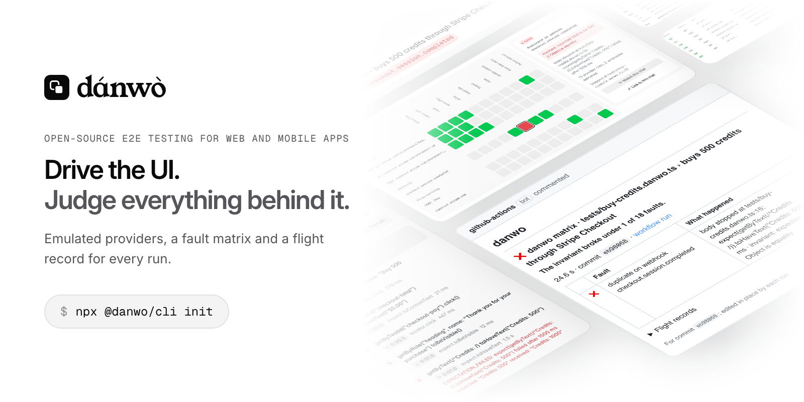

<picture>
  <source media="(prefers-color-scheme: dark)" srcset="brand/readme-hero/hero-dark.png">
  
</picture>

<br>

<h3 align="center">dánwò</h3>

<p align="center">
  The open-source end-to-end testing framework for web and mobile apps.<br>
  Drive your app through its UI like a user, and check what happened behind it when you need to.
  <br>
  <a href="https://danwo.dev"><strong>Learn more »</strong></a>
</p>

<p align="center">
  <a href="https://danwo.dev/docs/quickstart">Quickstart</a> ·
  <a href="https://danwo.dev/docs">Docs</a> ·
  <a href="https://danwo.dev/docs/what-you-can-test">What you can test</a> ·
  <a href="https://danwo.dev/docs/fault-matrix">Fault matrix</a> ·
  <a href="https://danwo.dev/docs/coding-agents">Coding agents</a> ·
  <a href="CONTRIBUTING.md">Contributing</a>
</p>

<p align="center">
  <a href="LICENSE"></a>
  
  <a href="https://www.npmjs.com/package/@danwo/cli"></a>
  
</p>

<br>

danwo is a complete UI testing framework on its own: locators, plain-English agent steps that
replay with no model calls, and screenshot comparison, in a browser, on Android or on iOS. When
your app takes payments, sends email or handles webhooks, turn on the backend layer: emulated
providers, invariants and a fault matrix.

## A test

```ts
import { test } from "@danwo/sdk"

test("signs up", async ({ app, screen, expect }) => {
  await app.open("/sign-up")
  await screen.getByLabel("Email").fill("ada@example.com")
  await screen.getByLabel("Password").fill("correct horse battery staple")
  await screen.getByRole("button", { name: "Create account" }).click()

  await expect(screen.getByRole("heading", { name: "Welcome, Ada" })).toBeVisible()
})
```

No providers, keys or model. Steps can also be plain English, recorded once and replayed after:

```ts
await agent.act("add two blue mugs to the basket and go to checkout")
await agent.assert("the basket shows two blue mugs")
await expect(screen).toHaveScreenshot("checkout")
```

## Quickstart

You need Node.js 22.22.3 or a later 22, or 24.11.1 or newer, on macOS, Linux or Windows (web
tests; mobile tests need macOS or Linux). In your app's folder:

```sh
npx @danwo/cli init
npm run test:danwo
```

`init` asks what to test, which model and providers to use (pick none for a UI-only start) and
which coding agents to set up. It writes a config and a first test that passes, and installs the
browser. See the [quickstart](https://danwo.dev/docs/quickstart).

## Add the backend layer when you need it

|                            |                                                                                                                                        |
| -------------------------- | -------------------------------------------------------------------------------------------------------------------------------------- |
| **Emulates the providers** | Stripe, Clerk, Resend, Google, Slack and 20 more answer from local emulators behind a proxy. No sandbox keys, no code changes.         |
| **Judges the backend**     | An invariant reads your database and the provider after the test: one row, one charge, one email.                                      |
| **Breaks it on purpose**   | `danwo matrix` reruns a test once per fault: 500s, declines, duplicate webhooks, lost database commits. The invariant judges each run. |

```ts
test("joins the waitlist", async ({ app, screen, expect }) => {
  await app.open("/")
  await screen.getByLabel("Work email").fill(EMAIL)
  await screen.getByRole("button", { name: "Join the waitlist" }).click()

  await expect(screen.getByRole("status")).toContainText("You're on the list")
}).invariant(async ({ databaseUrl, resend, expect }) => {
  // Whatever went wrong on the way: one row, one welcome email.
  expect(await sql(databaseUrl, "select id from signups where email = $1", [EMAIL])).toHaveLength(1)
  expect(resendInbox(resend).list(EMAIL)).toHaveLength(1)
})
```

```sh
npx @danwo/cli matrix tests/waitlist.danwo.ts
```

```text
PASS  status 429 on POST api.resend.com/emails
PASS  reset-after on POST api.resend.com/emails
PASS  serialization_failure on INSERT signups (postgres)
PASS  double-submit on POST /api/join
…
faults: 16 passed
```

Remove the app's idempotency key and two trials turn red: a second welcome email went out.
See [the fault matrix](https://danwo.dev/docs/fault-matrix).

Every run, with or without the backend layer, leaves a flight record: video, steps, and the calls
behind them, in a dashboard, a PR comment and over MCP.

## Examples

Each one runs with no real keys. Clone, install, test.

| Example                                 | What it shows                                                                |
| --------------------------------------- | ---------------------------------------------------------------------------- |
| [`commerce`](examples/commerce)         | A shop on Next.js, Hono, Postgres and Stripe Checkout. 86 faults held.       |
| [`saas`](examples/saas)                 | Workspaces, a trial and billing, Slack and Google, Inngest jobs, live notes. |
| [`clerk-login`](examples/clerk-login)   | The real Clerk components, Google sign-in and org invites, on the emulator.  |
| [`better-auth`](examples/better-auth)   | Self-hosted Better Auth: email codes, Google and GitHub, linked accounts.    |
| [`with-next`](examples/with-next)       | The smallest one: a Next.js waitlist on Postgres and Resend.                 |
| [`with-swiftui`](examples/with-swiftui) | The same waitlist as a native SwiftUI app on the iOS Simulator.              |
| [`with-compose`](examples/with-compose) | The same waitlist as a native Jetpack Compose app on an Android emulator.    |
| [`with-flutter`](examples/with-flutter) | The same waitlist as a Flutter app, on an Android emulator or iOS Simulator. |

More in the [examples gallery](https://danwo.dev/docs/examples).

## Where it runs

|                                                       |                                                                            |
| ----------------------------------------------------- | -------------------------------------------------------------------------- |
| [Web apps](https://danwo.dev/docs/web)                | Any framework, started by danwo or already running.                        |
| [Android](https://danwo.dev/docs/android-tests)       | Expo, React Native, Jetpack Compose and Views apps on an emulator.         |
| [iOS](https://danwo.dev/docs/ios-tests)               | Expo, React Native, SwiftUI and UIKit apps on an iOS Simulator.            |
| [Playwright Test](https://danwo.dev/docs/playwright)  | Keep your tests, add emulators and the matrix.                             |
| [From Cypress](https://danwo.dev/docs/cypress)        | Move a Cypress suite over one spec at a time.                              |
| [From Detox](https://danwo.dev/docs/detox)            | Move a Detox suite over one test file at a time.                           |
| [Real stacks](https://danwo.dev/docs/real-stacks)     | Several apps, workers, databases and background jobs behind one proxy.     |
| [CI](https://danwo.dev/docs/ci)                       | A GitHub Check and a PR comment that say what broke and whose fault it is. |
| [Coding agents](https://danwo.dev/docs/coding-agents) | A skill and an MCP server for Claude Code, Cursor and Codex.               |

## Contributing

Node 22.22.3+ or 24.11.1+, and bun:

```sh
bun install
bun run check
```

See [CONTRIBUTING.md](CONTRIBUTING.md), the [Code of Conduct](CODE_OF_CONDUCT.md), and
[SECURITY.md](SECURITY.md) for reporting a vulnerability. danwo is early: APIs will change.

## The name

_Dánwò_ is Yorùbá for "to test". It comes from _dán … wò_, "try it and see": you put something
to the test and watch what happens. Say it _DAHN-woh_, high then low.

## Licence

The code is under the [Apache License 2.0](LICENSE). The dánwò name and logo are trademarks of
Carbonme Inc; see [TRADEMARKS.md](TRADEMARKS.md).
