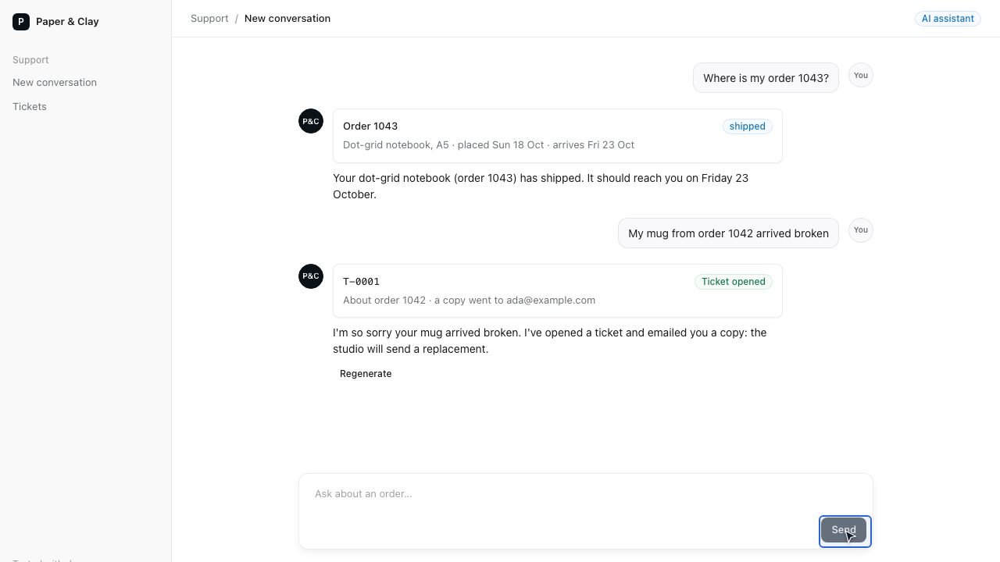
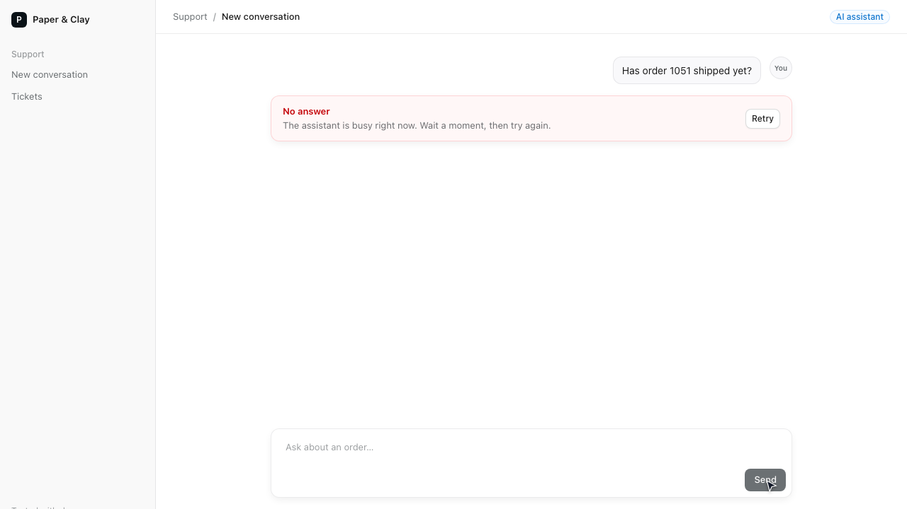

# AI chat with tools

Paper & Clay is a small studio that sells mugs, notebooks and prints. Its support page is a chat
with an assistant on the Next.js App Router and the Vercel AI SDK (`useChat`, `streamText`). The
answer streams in word by word, through the Vercel AI Gateway. The assistant has two tools:
`lookupOrder` reads an order from Postgres, and `createTicket` opens a ticket in Postgres and
emails the customer a copy through Resend. Every conversation is saved as it goes. An answer can
be regenerated, and a rate limit or an outage shows a plain message with a Retry button.

danwo tests it with no model key and no Resend account. Its model API emulator plays the AI
Gateway and answers each call from a script, tool calls included, so every run gets the same
answers. Its Resend emulator catches the emails, and each worker gets a throwaway Postgres.



## What this shows

- **The app's model, scripted.** Each test gets the model answers it needs, the tool calls
  included, with `llmScripts(llm).add(...)`. A script can answer differently once a tool has
  failed, so the scripted model never claims a ticket it didn't open.
- **Model faults on cue.** One test makes the model rate-limited three times and then answer.
  Others script a refusal and a tool call with the wrong arguments.
- **A matrix over every way a model call fails:** 429, 500, 503, a prompt that's too long, a slow
  or dropped answer, a refusal, an empty or cut-off answer, a content filter, a malformed tool call
  and a broken stream. It also fails Resend and the app's own SQL. The app holds under all 49.
- **Invariants that read Postgres, Resend and the page:** one ticket per request, one email per
  ticket, tool writes only with valid arguments, the saved conversation the same as the one on
  the page, and never a raw error.
- **danwo's agent in the chat, then replayed.** The agent test asks the assistant for a ticket in
  plain words. On the second run it replays from danwo's cache with no model calls.

## Two models, and only one needs a key

| Model                                                 | Who calls it                                                                                                | In the tests                                                                                                      |
| ----------------------------------------------------- | ----------------------------------------------------------------------------------------------------------- | ----------------------------------------------------------------------------------------------------------------- |
| **The app's model** (`openai/gpt-5-mini`)             | The app's `/api/chat` route, through the AI Gateway (`AI_GATEWAY_API_KEY`)                                  | danwo's emulator answers it from scripts. The key is fake (`vck_danwo_emulated`), and nothing leaves the machine. |
| **danwo's agent model** (`anthropic/claude-sonnet-5`) | danwo itself, for `agent.act` and `agent.assert` in `tests/agentic.danwo.ts`; it never goes through the app | A real model: set `AI_GATEWAY_API_KEY` to run the agent test. Without it, the test is skipped.                    |

`danwo.config.ts` gives the app its own fake key, so a real key set for danwo's agent never
reaches the app. To try the agent test with no key at all, `DANWO_MODEL=scripted` runs it on a
small scripted model (`tests/agent-model.ts`) that types the request and presses Send.

## Run

Use Node 24 and Docker. From this folder:

```sh
npm install
npm test
```

```text
Running 8 tests with 2 workers
  - tests/agentic.danwo.ts › the agent asks the assistant to open a ticket 0 ms, worker 0
  ✓ tests/deterministic.danwo.ts › looks up an order 1921 ms, worker 1
  ✓ tests/deterministic.danwo.ts › opens a ticket for a broken mug 1762 ms, worker 1
  ✓ tests/deterministic.danwo.ts › streams the answer in as it is written 1844 ms, worker 1
  ✓ tests/deterministic.danwo.ts › shows a retry message when the model is rate-limited, and the retry works 3949 ms, worker 1
  ✓ tests/deterministic.danwo.ts › rejects a malformed tool call without writing anything 1638 ms, worker 1
  ✓ tests/deterministic.danwo.ts › shows a refusal as a refusal 1482 ms, worker 1
  ✓ tests/deterministic.danwo.ts › regenerates an answer 2112 ms, worker 1

7 passed, 1 skipped
```

The first run builds the app (`next build`) and pulls `postgres:17-alpine`. Each worker then
starts its own Postgres container, the model API and Resend emulators and `next start`, and
removes them when it ends. If Chromium is missing, danwo tells you to run
`npx @danwo/cli install-browser`.

| Script                 | What it runs                                                 |
| ---------------------- | ------------------------------------------------------------ |
| `npm test`             | every test; the agent test skips without a model key         |
| `npm run test:agentic` | the agent test alone                                         |
| `npm run matrix:plan`  | what the ticket's fault matrix would try, without running it |
| `npm run matrix`       | the ticket's fault matrix: 49 trials, under two minutes      |
| `npm run matrix:order` | the same for looking an order up                             |
| `npm run serve`        | danwo's dashboard over everything the runs recorded          |
| `npm run typecheck`    | `tsc` over the app and the tests                             |

### Use your own Postgres

Without Docker, point `DATABASE_URL` at a Postgres you run. Its database name must end in `_test`;
each worker creates `support_w0_test`, `support_w1_test` and so on beside it, so the role needs
`CREATEDB`:

```sh
DATABASE_URL=postgres://postgres@127.0.0.1:5432/support_test npm test
```

## The tests

| Test                                    | What it proves                                                                                             |
| --------------------------------------- | ---------------------------------------------------------------------------------------------------------- |
| looks up an order                       | the model calls `lookupOrder`; the order card shows the status read from Postgres, then the model's answer |
| opens a ticket for a broken mug         | "my mug from order 1042 arrived broken" opens exactly one ticket, with exactly one email                   |
| streams the answer in as it is written  | the answer is redrawn word by word as it streams, and ends `answered`                                      |
| shows a retry message when rate-limited | three 429s run out the AI SDK's retries; the page says the assistant is busy; Retry gets the answer        |
| rejects a malformed tool call           | `createTicket` called with a number for the order and a reason that isn't one: nothing written, no email   |
| shows a refusal as a refusal            | the model's refusal is shown with "The assistant declined to answer this."                                 |
| regenerates an answer                   | Regenerate replaces the answer, on the page and in Postgres                                                |

The seed (`tests/scripts.ts`) holds the two journeys most tests share: where order 1043 is, and a
ticket for order 1042. The answer after a tool call depends on what the tool handed back, as a
real model's would. A test adds scripts for its own case, and a reset drops them again:

```ts title="tests/deterministic.danwo.ts"
llmScripts(llm).add({
  match: { user: /has order 1051 shipped/i },
  reply: [
    { error: "rate-limit" },
    { error: "rate-limit" },
    { error: "rate-limit" },
    { text: "Not yet: your tide print is still being made. We'll email you when it ships." },
  ],
})
```



## The matrix

A model call can go wrong in thirteen ways. By default `danwo matrix` tries the three most telling
on each call, so the scripts pass `--thorough` to try them all:

```sh
npm run matrix
```

```text
clean run passed; 49 faults planned
38 of 87 possible faults left out: 38 on repeats of a route or statement
PASS  status 429 on POST ai-gateway.vercel.sh/v4/ai/language-model
PASS  status 500 on POST ai-gateway.vercel.sh/v4/ai/language-model
PASS  reset-after on POST ai-gateway.vercel.sh/v4/ai/language-model
PASS  malformed-tool-call on POST ai-gateway.vercel.sh/v4/ai/language-model
PASS  stream-cut on POST ai-gateway.vercel.sh/v4/ai/language-model
PASS  reset-after on POST api.resend.com/emails
PASS  reset-after on INSERT tickets (postgres)
PASS  reset-after on COMMIT (postgres)
PASS  double-submit on POST /api/chat
        POST /api/chat sent twice at once: 200 and 200
  …
faults: 49 passed
50 runs in 98 s
```

Most faulted trials stop early (`body stopped at …`): the test expects the ticket, and a refusal
or a cut-off stream means there isn't one. The invariant judges every trial however far it got.
`supportHeld` in `tests/support.ts` checks:

- every ticket fits `createTicket`'s schema and is about an order that exists;
- at most one ticket per conversation and order;
- exactly one ticket email per ticket, and none for a ticket that doesn't exist;
- once no answer is coming, the page shows the conversation Postgres kept, every answer with how it
  ended;
- the page shows no raw error text: no "Rate limit reached", no "fetch failed", no SDK error name.

### What keeps it green

| Fault                                              | What the app does                                                                                     |
| -------------------------------------------------- | ----------------------------------------------------------------------------------------------------- |
| The gateway answers 429, 500 or 503, or drops      | the AI SDK retries twice, after the gateway's `Retry-After`; past that, a plain message and Retry     |
| A prompt that's too long (400)                     | not retried; "Something went wrong with this answer" and Retry                                        |
| A refusal or a content filter                      | the answer is shown with "The assistant declined to answer this."                                     |
| An empty answer, one cut short, a stream cut off   | the answer is marked ("didn't reply", "cut short", "interrupted") and saved that way, with Regenerate |
| A malformed tool call                              | the AI SDK checks the input against the zod schema and refuses it; the model hears why                |
| Resend fails or the answer is lost                 | retries with the same `Idempotency-Key`, `ticket/T-0001`: one email                                   |
| The ticket's `INSERT` lost, or done but unanswered | an upsert, one ticket per conversation and order                                                      |
| Saving the conversation fails mid-transaction      | the whole save is retried; it writes the full list each time, so a repeat changes nothing             |
| The same message sent twice at once                | both reach the same ticket and the same idempotency key: one ticket, one email                        |

## Make it break

`AI_CHAT_BUG` turns one of the app's safeguards off. Run the matrix with it and watch the trials
that catch it go red. Everything else still passes.

**`AI_CHAT_BUG=no-tool-validation npm run matrix`** trusts the model's tool input. `createTicket`
gets a JSON schema with nothing checking calls against it, and a call whose input broke off is
"repaired" by finishing the JSON it started. One trial fails: the model's call broke off before its
`reason`, the repair kept the rest, and a ticket was written without one.

```text
FAIL  malformed-tool-call on POST ai-gateway.vercel.sh/v4/ai/language-model
        invariant: T-0001 was opened with valid arguments: expected 'reason: Invalid option: expected one …' to be ''
faults: 48 passed, 1 failed
```

`npm test` catches it too. "rejects a malformed tool call" fails with a ticket for order 1043 whose
reason is `torn` and whose summary is empty.

**`AI_CHAT_BUG=no-retry npm run matrix`** calls the model once, with no retries, and shows its
error as it came. Six trials fail: every 429, 500, 503, 400, reset and lost answer on the model's
first call puts the gateway's own words on the page.

```text
FAIL  status 429 on POST ai-gateway.vercel.sh/v4/ai/language-model
        invariant: no raw error text on the page: expected 'Rate limit reached for requests' to be ''
FAIL  reset on POST ai-gateway.vercel.sh/v4/ai/language-model
        invariant: no raw error text on the page: expected 'Invalid error response format: Gatewa…' to be ''
  …
faults: 43 passed, 6 failed
```

In `npm test`, "shows a retry message when the model is rate-limited" fails: the page says "Rate
limit reached for requests" instead of the busy message.

To rerun one trial while you fix it, pass its label to `--faults`:

```sh
AI_CHAT_BUG=no-retry npx @danwo/cli matrix tests/deterministic.danwo.ts \
  --grep "opens a ticket for a broken mug" --thorough --faults "^status 429 on POST ai-gateway"
```

## Agent tests and the replay cache

`tests/agentic.danwo.ts` asks danwo's agent to "ask the assistant to open a ticket for order 1042
because the mug arrived broken". The agent finds the message box and Send by itself. A model-free
check follows: one ticket in Postgres and one email in the Resend emulator. Set a
[Vercel AI Gateway](https://vercel.com/docs/ai-gateway) key for danwo's agent to run it:

```sh
AI_GATEWAY_API_KEY="your-key" npm run test:agentic
```

The first run asks the model and keeps each verified step in `.danwo/cache`. Every run after it
replays them, with no model calls. With the scripted model the same holds, and you can see it
without a key:

```sh
DANWO_MODEL=scripted npm run test:agentic   # first run: records
DANWO_MODEL=scripted npm run test:agentic   # second run: replays
```

```text
1 passed
cache: 0 replayed · 0 relocated · 0 handed off · 2 missed · 2 recorded
model: 4 calls · 400 in / 40 out

1 passed
cache: 2 replayed · 0 relocated · 0 handed off · 0 missed
```

The second run has no `model:` line: none of danwo's agent steps called a model. The app's model
was the emulator both times.

## Against a local build of danwo

To run this example against danwo's source instead of the published packages, while you work
on danwo, build the packages and install the example from them, from the root of the danwo
repository:

```sh
bun install
bun run release 0.1.3 --pack
node examples/link.ts ai-chat
```

`link.ts` copies the example to a temporary folder, points danwo's packages at the tarballs in
`dist/release`, runs `npm install` there and prints the folder. Run the commands above from it.
`node examples/link.ts ai-chat --here` installs into this folder instead, for your editor.

## Run it for real

`npm run dev` runs the app against the real AI Gateway. It needs `AI_GATEWAY_API_KEY`,
`RESEND_API_KEY` and a `DATABASE_URL` whose database has the tables in `lib/db.ts` and a few
orders (`SEED_ORDERS` in `lib/orders.ts`).

## The files

| File                                      | What it does                                                                         |
| ----------------------------------------- | ------------------------------------------------------------------------------------ |
| `app/api/chat/route.ts`                   | the chat route: saves the question, streams the answer, saves it with how it ended   |
| `lib/assistant.ts`                        | the instructions, the two tools and their zod schemas, `streamText` with retries     |
| `lib/tickets.ts`, `lib/mail.ts`           | a ticket opened once per conversation and order, and its email sent once             |
| `lib/conversations.ts`, `lib/messages.ts` | the saved conversation, and how an answer ended                                      |
| `lib/errors.ts`                           | what the customer reads when the model fails                                         |
| `lib/bugs.ts`                             | the `AI_CHAT_BUG` switches                                                           |
| `app/chat.tsx`, `app/tool-part.tsx`       | `useChat`, the messages, the order and ticket cards, Retry and Regenerate            |
| `danwo.config.ts`                         | the worker's Postgres, data proxy, snapshot, model API and Resend emulators, and app |
| `tests/scripts.ts`                        | what the app's model answers                                                         |
| `tests/support.ts`                        | the steps every chat takes, and `supportHeld`, the invariant                         |
| `tests/deterministic.danwo.ts`            | seven tests on scripted answers                                                      |
| `tests/agentic.danwo.ts`                  | the agent test, with a model-free check                                              |
| `tests/agent-model.ts`                    | danwo's agent model, or the scripted one with `DANWO_MODEL=scripted`                 |

Read more in [Scripting replies](https://danwo.dev/docs/providers/model-scripts) and
[Model APIs](https://danwo.dev/docs/providers/model-apis).

Last checked with danwo 0.1.3, Next.js 16.4, AI SDK 7.0, Postgres 17, and Node 24.
