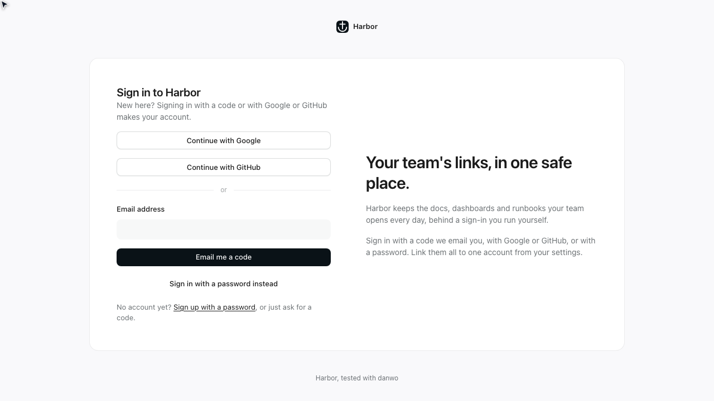
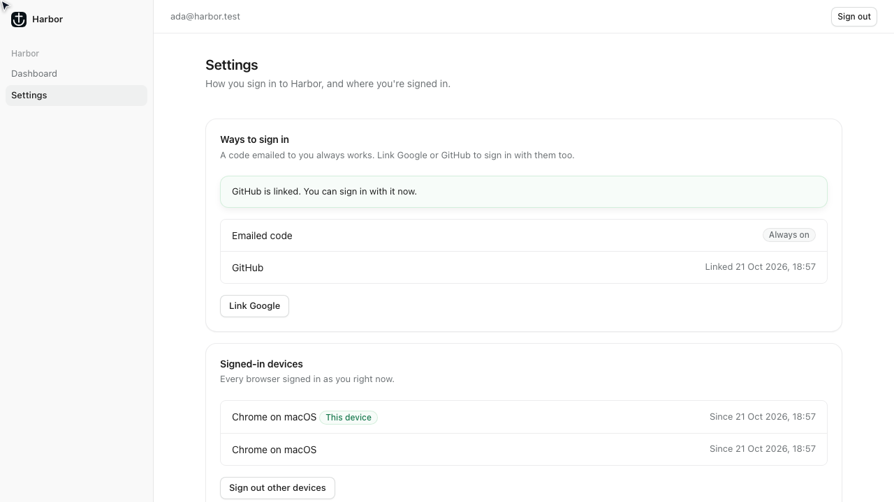
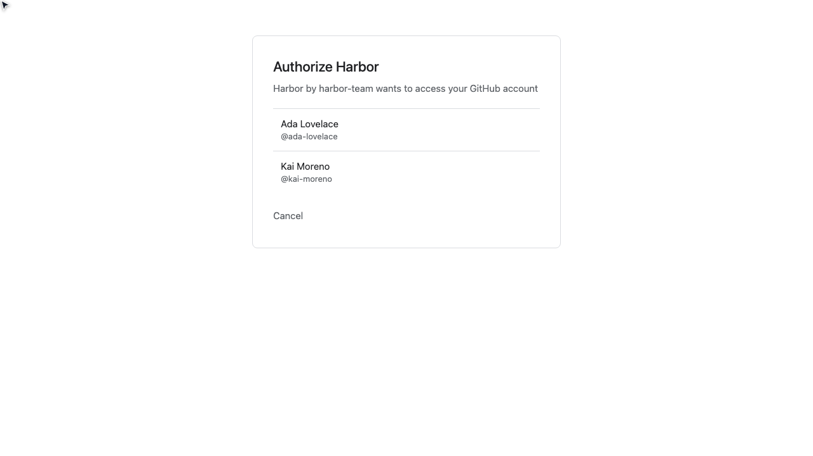

# Login with Better Auth

Harbor is a small app for keeping a team's links, with sign-in it runs itself. Its web app is
Vite and React (React Router), served by a Hono API that runs [Better Auth](https://better-auth.com)
on Postgres. People sign in with a six-digit code emailed through Resend, with Google or GitHub, or
with a password once they've confirmed their email from a link. Behind sign-in are a dashboard and
a settings page that lists the ways you sign in (and links Google or GitHub to the account), lists
the devices signed in as you, and signs out every one but this.

None of it talks to Resend, Google or GitHub. danwo runs Harbor against its Resend emulator and
the Google and GitHub emulators' own consent screens. Each test worker gets its own Postgres, and
every other outside call is blocked.



## What this shows

- **Better Auth's own tables, checked.** People, linked accounts, sessions, codes and rate-limit
  counters all live in Harbor's Postgres. The invariants read them after every test and trial:
  one user row per person however they signed in, one account row per provider link, signed-out
  sessions gone from the table, and exactly one email per code.
- **No real Google or GitHub app, no real email.** "Continue with Google" and "Continue with
  GitHub" land on the emulators' consent screens. The code Harbor emails arrives in the `mail`
  fixture (`mail.code`), and so does the confirmation link (`mail.link`). A second browser signs
  in as the same person, and the first signs it out.
- **Brute force refused.** A fourth code request within five minutes gets Better Auth's 429. Three
  wrong guesses kill the code, so even the right one is refused after them. `time.travel` past
  five minutes expires it.
- **A matrix the sign-in survives.** `danwo matrix` fails Resend (429, 5xx, slow, a lost answer),
  GitHub's token endpoint and user API, and Better Auth's own SQL, the session insert included,
  and sends forms twice at once. Harbor passes all of them. `BETTER_AUTH_BUG` turns a safeguard
  off, so you can watch a trial catch it.



## Run

Use Node 24 and Docker. From this folder:

```sh
npm install
npm test
```

```text
Running 15 tests with 2 workers
  - tests/agentic.danwo.ts › the agent signs in as Ada with the code Harbor emails 0 ms, worker 0
  - tests/agentic.danwo.ts › the agent counts Ada's signed-in devices 0 ms, worker 0
  ✓ tests/deterministic.danwo.ts › signs up with an emailed code 2331 ms, worker 1
  ✓ tests/deterministic.danwo.ts › signs in with an emailed code 2090 ms, worker 1
  ✓ tests/deterministic.danwo.ts › signs in with Google on Google's own page 1447 ms, worker 1
  ✓ tests/deterministic.danwo.ts › signs in with GitHub on GitHub's own page 1465 ms, worker 1
  ✓ tests/deterministic.danwo.ts › joins Ada's Google sign-in to the account she already has 1421 ms, worker 1
  ✓ tests/deterministic.danwo.ts › links GitHub from the settings page, then signs in with it 4035 ms, worker 1
  ✓ tests/deterministic.danwo.ts › signs up with a password and confirms by email 3919 ms, worker 1
  ✓ tests/deterministic.danwo.ts › refuses a wrong code 2110 ms, worker 1
  ✓ tests/deterministic.danwo.ts › stops a code working after three wrong guesses 4282 ms, worker 1
  ✓ tests/deterministic.danwo.ts › refuses a code once it has expired 2203 ms, worker 1
  ✓ tests/deterministic.danwo.ts › turns away a fourth code request within five minutes 2795 ms, worker 1
  ✓ tests/deterministic.danwo.ts › signs out 1250 ms, worker 1
  ✓ tests/deterministic.danwo.ts › signs out every other device 7777 ms, worker 1

13 passed, 2 skipped
```

The first run builds the web app (`vite build web`) and pulls `postgres:17-alpine`. Each worker
then starts its own Postgres container, makes Better Auth's tables with the app's own
`npm run migrate`, starts the Resend, Google and GitHub emulators and the API, and removes them
all when it ends. If Chromium is missing, danwo tells you to run
`npx @danwo/cli install-browser`.

The scripts:

| Script                    | What it runs                                                                       |
| ------------------------- | ---------------------------------------------------------------------------------- |
| `npm test`                | every test; the agent tests skip without a model key                               |
| `npm run matrix:plan`     | what the code sign-up's fault matrix would try, without running it                 |
| `npm run matrix`          | the code sign-up's fault matrix: 37 trials, under a minute                         |
| `npm run matrix:link`     | the same for linking GitHub from the settings page: 26 trials, under a minute      |
| `npm run matrix:password` | the same for signing up with a password: 37 trials, about a minute and a half      |
| `npm run serve`           | danwo's dashboard over everything the runs recorded                                |
| `npm run typecheck`       | `tsc` over the API, the tests and the web app                                      |
| `npm run dev`             | the web app on port 5173, with `npm run dev:api` beside it on 3000 (your own keys) |

### Use your own Postgres

Without Docker, point `DATABASE_URL` at a Postgres you run. Its database name must end in `_test`;
each worker creates `harbor_w0_test`, `harbor_w1_test` and so on beside it, so the role needs
`CREATEDB`:

```sh
DATABASE_URL=postgres://postgres@127.0.0.1:5432/harbor_test npm test
```

## The tests

| Test                                                 | What it proves                                                                                         |
| ---------------------------------------------------- | ------------------------------------------------------------------------------------------------------ |
| signs up with an emailed code                        | a new address gets a code from `mail.code()`, and the code makes the account                           |
| signs in with an emailed code                        | Ada's seeded account, and exactly one session row for her                                              |
| signs in with Google on Google's own page            | the Google emulator's account chooser, and a new user with one `google` account row                    |
| signs in with GitHub on GitHub's own page            | the GitHub emulator's consent screen, and a new user with one `github` account row                     |
| joins Ada's Google sign-in to the account she has    | Google vouches for her address, so Better Auth links it: still one Ada                                 |
| links GitHub from the settings page, then signs in   | "Link GitHub" on settings, under another address; signing in with GitHub is then Ada's account         |
| signs up with a password and confirms by email       | the password refuses to work until the link from `mail.link()` is opened, which signs her in           |
| refuses a wrong code                                 | "That code isn't right", and the code still works                                                      |
| stops a code working after three wrong guesses       | Better Auth's attempt limit: the right code is refused after three wrong ones                          |
| refuses a code once it has expired                   | `time.travel({ minutes: 6 })`, and the five-minute code is refused                                     |
| turns away a fourth code request within five minutes | Better Auth's rate limiter answers 429; three emails went out, not four                                |
| signs out                                            | the top bar's "Sign out"; Ada's session row is gone and the app's pages send her to sign in            |
| signs out every other device                         | Ada on her phone too (`users.open`), then "Sign out other devices": one session left, the phone's gone |

One saved session, `signed-in-ada`, signs Ada in with a code once per worker.

### The matrix, clean

```text
faults: 37 passed
38 runs in 55 s
```

Linking GitHub passes all 26 of its trials, and the password sign-up all 37.

Some trials stop the test early and still pass, because the invariants hold. A `COMMIT` whose
answer was lost may have committed, so Harbor says "Something went wrong" rather than guess, and
the person asks again. A Resend answer ten seconds late leaves the page waiting for those ten
seconds. GitHub's token endpoint failing sends the browser back to settings with "Signing in there
didn't finish", and nothing is linked.

## Make it break

`BETTER_AUTH_BUG` turns one of Harbor's safeguards off. Run the matrix or the tests with it and
watch the trial that catches it go red. Everything else still passes.

**`BETTER_AUTH_BUG=no-idempotency-key npm run matrix`** sends email without Resend's idempotency
key. One trial fails: Resend sent the code, its answer was lost, and the retry sent it again.

```text
FAIL  reset-after on POST api.resend.com/emails
        invariant: exactly one email per code: expected [ 'grace@harbor.test 743243', …(1) ] to deeply equal [ 'grace@harbor.test 743243' ]
```

**`BETTER_AUTH_BUG=no-unique-email npm run matrix:password`** drops the unique constraint on the
user's email. One trial fails: the sign-up form sent twice at once made two Maes.

```text
FAIL  double-submit on POST /api/auth/sign-up/email
        invariant: one user row per person: expected [ { email: 'mae@harbor.test', …(1) } ] to deeply equal []
```

Better Auth looks the address up before it inserts, but two requests at once both find nobody.
Only the database can refuse the second.

**`BETTER_AUTH_BUG=no-rate-limit npm test`** turns Better Auth's rate limiter off. One test fails:
the fourth code request goes through.

```text
✗ tests/deterministic.danwo.ts › turns away a fourth code request within five minutes  [App bug (likely)]
  EXPECTATION_FAILED: expect(getByRole("alert")).toHaveText(/Too many tries/) failed after 10000 ms
```

To rerun one trial while you fix it, pass its label to `--faults`:

```sh
BETTER_AUTH_BUG=no-idempotency-key npx @danwo/cli matrix tests/deterministic.danwo.ts \
  --grep "signs up with an emailed code" --faults "^reset-after on POST api.resend.com"
```

## How the app stays correct

| Fault                                                    | What the app does                                                                                                                     |
| -------------------------------------------------------- | ------------------------------------------------------------------------------------------------------------------------------------- |
| Resend answers 429 or 5xx, or drops                      | the send retries, waiting out `Retry-After`; one idempotency key per send, so a lost answer isn't a second email                      |
| Resend fails for good                                    | Better Auth would answer "sent" anyway; Harbor answers 503, throws the code away, and the page says so                                |
| the code form sent twice at once                         | code requests for one address run one at a time, so the newest email always holds the code that works                                 |
| the sign-in form sent twice at once                      | the second copy gets the first one's answer (and session) instead of "wrong code"                                                     |
| the password sign-up sent twice at once                  | the unique email constraint refuses the second user                                                                                   |
| a serialization failure or deadlock                      | the statement runs again; inside a transaction, the transaction runs again from `BEGIN`, if every replayed statement answers the same |
| the connection drops under a read, an insert or a delete | it runs again on a fresh connection; an insert that had landed is read back by its id                                                 |
| the database is down or full for a few seconds           | new connections are retried for about four seconds                                                                                    |
| GitHub's or Google's token endpoint fails                | Better Auth sends the browser back with an error; the page says so, and nothing is half-linked                                        |

Harbor also adds the unique key Better Auth leaves off its `account` table, on the provider and its
account id, so a Google or GitHub account can belong to one person only.



## Agent tests

`tests/agentic.danwo.ts` has two agent tests: "the agent signs in as Ada with the code Harbor
emails", which reads the code from the email itself, and "the agent counts Ada's signed-in
devices". Each is paired with a check that needs no model: Ada's dashboard with one session in
Harbor's database, and the count the agent read against the session table.

They skip without a model key. Set a [Vercel AI Gateway](https://vercel.com/docs/ai-gateway) key
to run them:

```sh
AI_GATEWAY_API_KEY="your-key" npm run test:agentic
```

The first run records each step; later runs replay it with no model calls.

## Against a local build of danwo

To run this example against danwo's source instead of the published packages, while you work
on danwo, build the packages and install the example from them, from the root of the danwo
repository:

```sh
bun install
bun run release 0.1.4 --pack
node examples/link.ts better-auth
```

`link.ts` copies the example to a temporary folder, points danwo's packages at the tarballs in
`dist/release`, runs `npm install` there and prints the folder. Run the commands above from it.

To work on the example in this folder, with your editor finding its types, install it in place
instead:

```sh
node examples/link.ts better-auth --here
```

That leaves only `node_modules`, which git ignores. The package.json is put back as it was.

## Where things are

| Path              | What it is                                                                                             |
| ----------------- | ------------------------------------------------------------------------------------------------------ |
| `api/auth.ts`     | Better Auth: email codes, password with a confirmed email, Google, GitHub, linking, the rate limiter   |
| `api/guards.ts`   | what runs in front of the code endpoints: one request per address at a time, the 503 on a failed email |
| `api/db.ts`       | the Postgres pool Better Auth uses, with the retries above                                             |
| `api/mail.ts`     | the code and confirmation emails, through Resend with retries and idempotency keys                     |
| `api/migrate.ts`  | `npm run migrate`: Better Auth's tables, plus Harbor's unique key on linked accounts                   |
| `web/`            | the Vite and React app: sign-in, sign-up, dashboard and settings                                       |
| `danwo.config.ts` | the Resend, Google and GitHub emulators, Postgres behind the data proxy, the session, snapshots        |
| `tests/`          | the tests, the invariants (`harbor.ts`), and the build and database helpers                            |
| `kit/`            | the examples' shared styles, used as plain CSS                                                         |

Last checked with @danwo/cli 0.1.4, better-auth 1.7.12, Hono 4.13, Vite 8.3, React Router
8.5, Postgres 17 and Node 24.
