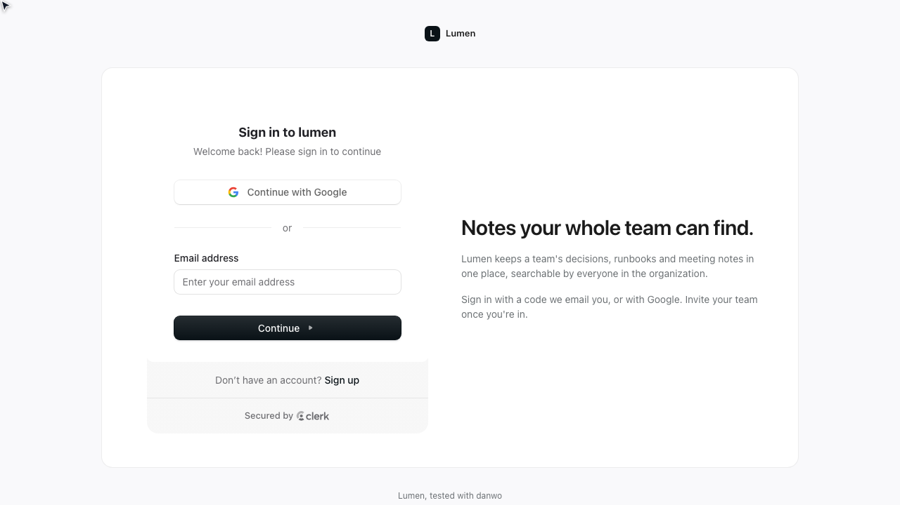
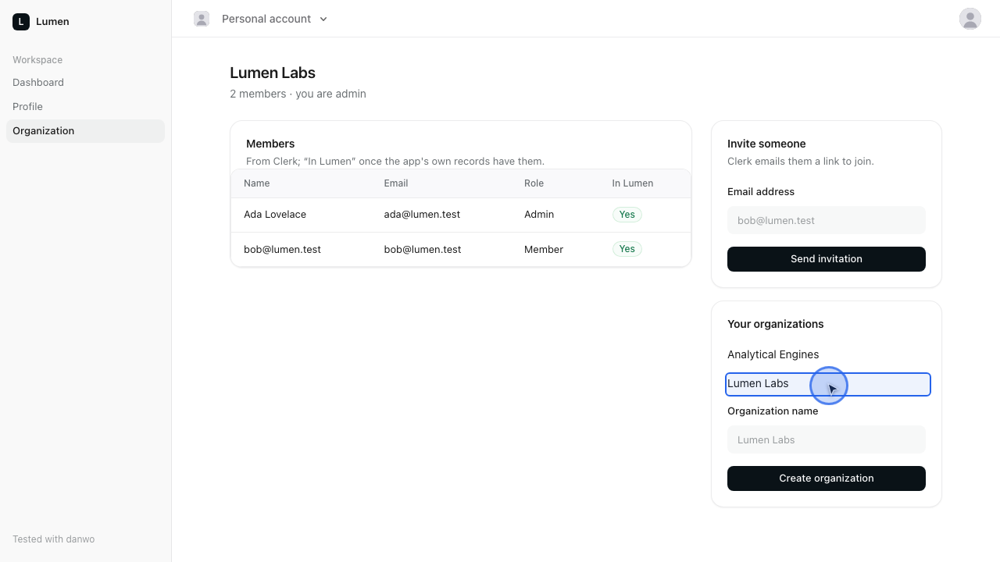

# Login with Clerk

Lumen is a small notes app on the Next.js App Router that signs people in with Clerk. Its sign-in
and sign-up pages are Clerk's own `<SignIn/>` and `<SignUp/>`, by emailed code or with Google. The
top bar has `<UserButton/>` and `<OrganizationSwitcher/>`. Behind them are a protected dashboard, a
profile page that reads `currentUser()`, and an organization page where Ada creates an organization,
invites people by email and sees who joined. Clerk's `user.created` and `organizationMembership.*`
webhooks write the app's own users and memberships to Postgres.

None of it talks to Clerk or Google. danwo runs the real ClerkJS against its Clerk emulator (a
development instance with stable ids), with "Continue with Google" handed to its Google emulator.
Each test gets a fresh database, and every other outside call is blocked.



## What this shows

- **Clerk's real components, no Clerk account.** `<SignIn/>`, `<SignUp/>`, `<UserButton/>` and
  `<OrganizationSwitcher/>` load from the emulator's Frontend API. The codes Clerk emails arrive
  in the `mail` fixture, and Google's account chooser is the Google emulator's.
- **A second person.** Ada invites Bob. Bob opens the invitation email in a browser of his own,
  lands on Lumen's sign-up page with Clerk's ticket, and joins her organization. Back in Ada's
  browser, he is in the member list.
- **Invariants that read both sides.** After every test there is exactly one app user per Clerk
  user and the same memberships on both sides. Every webhook Clerk didn't sign has been refused.
- **A matrix the sign-up survives.** `danwo matrix` fails Clerk's Backend API (429, 5xx, slow,
  dropped). It sends `user.created` twice, ten minutes late, forged and an hour stale, and fails
  the app's own `INSERT`. Lumen passes all of them. `CLERK_LOGIN_BUG` turns a safeguard off, so
  you can watch the matrix catch it.



## Run

Use Node 24 and Docker. From this folder:

```sh
npm install
npm test
```

```text
Running 11 tests with 2 workers
  - tests/agentic.danwo.ts › the agent signs in as Ada and opens her organization 0 ms, worker 0
  - tests/agentic.danwo.ts › the agent counts the members of Ada's organization 0 ms, worker 0
  ✓ tests/deterministic.danwo.ts › signs up with an emailed code 3744 ms, worker 1
  ✓ tests/deterministic.danwo.ts › signs in with an emailed code 3333 ms, worker 1
  ✓ tests/deterministic.danwo.ts › signs in with Google on Google's own page 2489 ms, worker 1
  ✓ tests/deterministic.danwo.ts › sends a signed-out visitor from the dashboard to sign in 1331 ms, worker 1
  ✓ tests/deterministic.danwo.ts › signs out 4078 ms, worker 1
  ✓ tests/deterministic.danwo.ts › creates an organization and invites Bob, who joins from the email 4429 ms, worker 1
  ✓ tests/deterministic.danwo.ts › refuses a wrong code 2231 ms, worker 1
  ✓ tests/deterministic.danwo.ts › refuses a code once it has expired 2268 ms, worker 1
  ✓ tests/deterministic.danwo.ts › shows Ada's seeded organization 3592 ms, worker 1

9 passed, 2 skipped
```

The first run builds the app (`next build`) and pulls `postgres:17-alpine`. Each worker then
starts its own Postgres container, the Clerk and Google emulators and `next start`, and removes
them when it ends. If Chromium is missing, danwo tells you to run
`npx @danwo/cli install-browser`.

The scripts:

| Script                  | What it runs                                                                         |
| ----------------------- | ------------------------------------------------------------------------------------ |
| `npm test`              | every test; the agent tests skip without a model key                                 |
| `npm run matrix:plan`   | what the sign-up's fault matrix would try, without running it                        |
| `npm run matrix`        | the sign-up's fault matrix: 22 trials, about 90 seconds                              |
| `npm run matrix:invite` | the same for creating an organization and inviting Bob: 31 trials, under two minutes |
| `npm run serve`         | danwo's dashboard over everything the runs recorded                                  |
| `npm run typecheck`     | `tsc` over the app and the tests                                                     |

### Use your own Postgres

Without Docker, point `DATABASE_URL` at a Postgres you run. Its database name must end in `_test`;
each worker creates `lumen_w0_test`, `lumen_w1_test` and so on beside it, so the role needs
`CREATEDB`:

```sh
DATABASE_URL=postgres://postgres@127.0.0.1:5432/lumen_test npm test
```

## The tests

| Test                                      | What it proves                                                                                 |
| ----------------------------------------- | ---------------------------------------------------------------------------------------------- |
| signs up with an emailed code             | `<SignUp/>`, the code from `mail.code()`, and the app's row from `user.created`                |
| signs in with an emailed code             | `<SignIn/>` by code; the profile page's `currentUser()` has Ada's stable id                    |
| signs in with Google on Google's own page | "Continue with Google", the Google emulator's chooser, and a new Clerk user linked to Google   |
| sends a signed-out visitor … to sign in   | the middleware (`proxy.ts`) guards `/dashboard` and `/organization`                            |
| signs out                                 | `<UserButton/>`'s sign-out; no session cookie left, and no live session in Clerk               |
| creates an organization and invites Bob … | Bob, in a second browser, accepts from the invitation email and shows up as a member           |
| refuses a wrong code                      | `<SignIn/>` shows Clerk's "Incorrect code"                                                     |
| refuses a code once it has expired        | `time.travel({ minutes: 11 })`, and the ten-minute code is refused                             |
| shows Ada's seeded organization           | the `ada-org-owner` session picks it in `<OrganizationSwitcher/>`; the app's seeded rows match |

Two saved sessions sign Ada in once per worker: `signed-in-ada`, and `ada-org-owner`, which also
picks her organization in the switcher.

### The matrix, clean

```text
faults: 22 passed
23 runs in 87 s
```

Every planned fault fires. The app checks session tokens offline with `CLERK_JWT_KEY`, so it reads
Clerk's keys once per worker; `matrix: { warmUp: true }` in `danwo.config.ts` runs the test once
before the clean run, so that read gets no fault. The only return from Clerk's site is the
dev-browser handshake on the first page, where the browser did nothing at Clerk, so it gets no
webhooks-before-redirect race.

The invite's matrix passes 30 of 31. Bob comes back from Clerk's invitation link before he signs
up, so its webhooks-before-redirect race finds no webhook waiting and is INVALID.

## Make it break

`CLERK_LOGIN_BUG` turns one of the app's safeguards off. Run the sign-up's matrix with it and
watch the trials that catch it go red. Everything else still passes.

**`CLERK_LOGIN_BUG=no-webhook-verify npm run matrix`** takes Clerk's webhooks without checking
their Svix signature. Two trials fail. A copy signed with the wrong secret was taken, and so was
one replayed with an hour-old signature:

```text
FAIL  forged on clerk webhook user.created
        invariant: webhooks Clerk didn't sign were refused: expected [ 'forged user.created' ] to deeply equal []
FAIL  stale 3600s on clerk webhook user.created
        invariant: webhooks Clerk didn't sign were refused: expected [ 'stale 3600s user.created' ] to deeply equal []
```

**`CLERK_LOGIN_BUG=no-upsert npm run matrix`** inserts a user for every `user.created` and drops
the unique index that would stop a second one. Two trials fail with two rows for Grace:

```text
FAIL  duplicate on clerk webhook user.created
        invariant: one app user per Clerk user: expected [ …(3) ] to deeply equal [ …(2) ]
FAIL  reset-after on INSERT app_users (postgres)
        invariant: one app user per Clerk user: expected [ …(3) ] to deeply equal [ …(2) ]
```

The second is the subtle one: the `INSERT` landed but its answer was lost, so the retry inserted
Grace again.

To rerun one trial while you fix it, pass its label to `--faults`:

```sh
CLERK_LOGIN_BUG=no-upsert npx @danwo/cli matrix tests/deterministic.danwo.ts \
  --grep "signs up with an emailed code" --faults "^duplicate on clerk webhook"
```

## How the app stays correct

| Fault                                              | What the app does                                                                                   |
| -------------------------------------------------- | --------------------------------------------------------------------------------------------------- |
| `user.created` twice, late, or before the redirect | the webhook upserts by Clerk id, and keeps the newest `updated_at`; the dashboard waits for the row |
| a forged or hour-old webhook                       | `verifyWebhook` refuses it with 400; Clerk's retry is signed fresh and lands                        |
| the `INSERT` fails, or its answer is lost          | retried as an upsert: one row per Clerk user, whichever happened                                    |
| the Backend API answers 429 or 5xx, or drops       | server actions retry, waiting out `Retry-After`; pages show what they have and look again           |
| creating an organization is retried or sent twice  | a taken slug that the same admin already owns is the answer, not a second organization              |
| an invitation is retried or sent twice             | each try looks for a pending invitation first, and two submits at once share one                    |

Pages don't retry inside a render: Next.js answers a repeated GET in one render from its first
answer, failure included. They say "trying again" and refresh a second later instead.

## Agent tests

`tests/agentic.danwo.ts` has two agent tests: "the agent signs in as Ada and opens her
organization", which reads Clerk's emailed code itself, and "the agent counts the members of Ada's
organization". Each is paired with a check that needs no model: the organization is on the screen
with Ada as admin, and the count the agent read is Clerk's.

They skip without a model key. Set a [Vercel AI Gateway](https://vercel.com/docs/ai-gateway) key
to run them:

```sh
AI_GATEWAY_API_KEY="your-key" npm run test:agentic
```

The first run records each step; later runs replay it with no model calls.

## Against a local build of danwo

To run this example against danwo's source instead of the published packages, while you work
on danwo, build the packages and install the example from them, from the root of the danwo
repository:

```sh
bun install
bun run release 0.1.2 --pack
node examples/link.ts clerk-login
```

`link.ts` copies the example to a temporary folder, points danwo's packages at the tarballs in
`dist/release`, runs `npm install` there and prints the folder. Run the commands above from it.

To work on the example in this folder, with your editor finding its types, install it in place
instead:

```sh
node examples/link.ts clerk-login --here
```

That leaves only `node_modules`, which git ignores. The package.json is put back as it was.

## Where things are

| Path                      | What it is                                                                           |
| ------------------------- | ------------------------------------------------------------------------------------ |
| `app/(auth)/`             | the sign-in and sign-up pages: Clerk's components in Lumen's card                    |
| `app/(app)/`              | the signed-in app: dashboard, profile, organization, and the top bar's Clerk widgets |
| `app/api/webhooks/clerk/` | Clerk's webhook: Svix signature check, then an upsert                                |
| `proxy.ts`                | Clerk's middleware, guarding the signed-in pages                                     |
| `lib/`                    | the app's users and memberships, organizations and invitations, Clerk with retries   |
| `danwo.config.ts`         | the Clerk and Google emulators, Postgres behind the data proxy, sessions, snapshots  |
| `tests/`                  | the tests, the invariants (`lumen.ts`) and the database helpers                      |
| `kit/`                    | the examples' shared styles, used through their Tailwind theme                       |

`@clerk/clerk-js` and `@clerk/ui` are dev dependencies only so the emulator serves the browser
those exact builds, with no download.

Last checked with @danwo/cli 0.1.2, Next.js 16.4, @clerk/nextjs 7.9, Postgres 17 and
Node 24.
