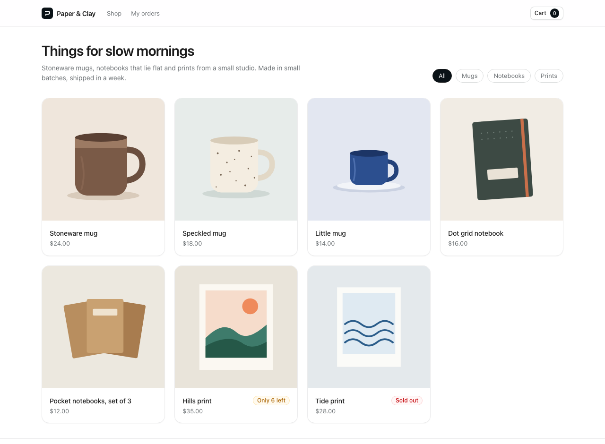
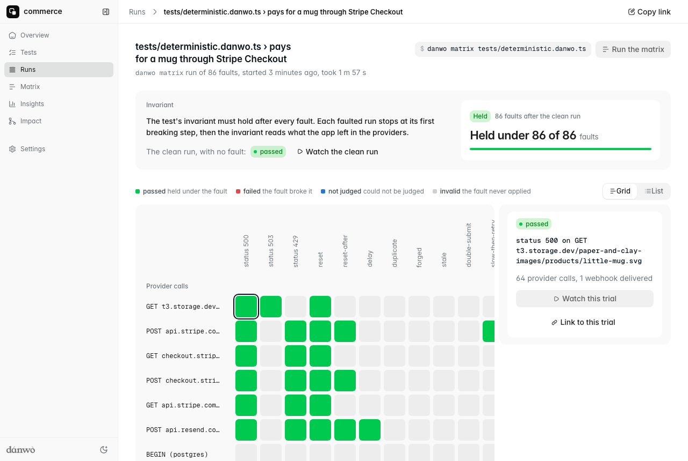

# Commerce

Paper & Clay is a small shop selling mugs, notebooks and prints. It has a Next.js storefront
(product grid, product pages, a cart, Stripe Checkout, an order confirmation and "My orders") and
a small admin with orders, refunds and stock levels. Behind it is a separate Hono API on Postgres.
The API talks to Stripe, sends receipts through Resend and keeps product pictures in S3.

None of those providers is real here. danwo runs Stripe, Resend and S3 as emulators, gives every
test a fresh database, and blocks every other outside call.



## What this shows

- **A whole stack behind one proxy.** danwo starts the API and the storefront, routes their calls
  to the Stripe, Resend and S3 emulators, and puts Postgres behind its data-fault proxy. The app's
  code has no test hooks.
- **Invariants that read both sides.** After every test, the shop's database is checked against
  Stripe and Resend: one order per paid Checkout Session, stock taken once per order, one receipt
  per order, totals equal to what Stripe charged, and refunds that agree with Stripe's.
- **A matrix the shop survives.** `danwo matrix` plans 86 faults on the purchase: Stripe 5xx, 429s
  and a declined card, duplicate, late, forged and stale webhooks, a double-submitted checkout,
  Resend and S3 failures, and Postgres serialization failures, deadlocks and lost COMMITs. The
  shop passes all of them, with retries, idempotency keys and webhook dedupe.
- **Bugs you can switch on.** `COMMERCE_BUG` turns one safeguard off, and the matrix shows which
  trials go red.



## Run

Use Node 24 and Docker. From this folder:

```sh
npm install
npm test
```

```text
Running 6 tests with 2 workers
  - tests/agentic.danwo.ts › buys the cheapest mug 0 ms, worker 0
  - tests/agentic.danwo.ts › finds my last order 0 ms, worker 0
  ✓ tests/deterministic.danwo.ts › browses the shop and fills a cart 2473 ms, worker 1
  ✓ tests/deterministic.danwo.ts › pays for a mug through Stripe Checkout 3179 ms, worker 1
  ✓ tests/deterministic.danwo.ts › a declined card shows Stripe's error and places no order 2649 ms, worker 1
  ✓ tests/deterministic.danwo.ts › refunds an order from the admin 3411 ms, worker 1

4 passed, 2 skipped
```

The first run builds the storefront (`next build web`) and pulls `postgres:17-alpine`. Each worker
then starts its own Postgres container, pushes the schema with `drizzle-kit push`, seeds the
catalogue, and starts the API and `next start` behind danwo's proxy; it removes them all when it
ends. If Chromium is missing, danwo tells you to run `npx @danwo/cli install-browser`.

The scripts:

| Script                  | What it runs                                                   |
| ----------------------- | -------------------------------------------------------------- |
| `npm test`              | every test; the agent tests skip without a model key           |
| `npm run matrix:plan`   | what the purchase's fault matrix would try, without running it |
| `npm run matrix`        | the purchase's fault matrix: 86 trials, about two minutes      |
| `npm run matrix:refund` | the same for refunding an order from the admin: 35 trials      |
| `npm run serve`         | danwo's dashboard over everything the runs recorded            |
| `npm run typecheck`     | `tsc` over the API, the tests and the storefront               |

### Use your own Postgres

Without Docker, point `DATABASE_URL` at a Postgres you run. Its database name must end in `_test`;
each worker creates `commerce_w0_test`, `commerce_w1_test` and so on beside it, so the role needs
`CREATEDB`:

```sh
DATABASE_URL=postgres://postgres@127.0.0.1:5432/commerce_test npm test
```

## Make it break

`COMMERCE_BUG` turns one of the shop's safeguards off. Run the purchase's matrix with it and watch
the trials that catch it go red. Everything else still passes.

**`COMMERCE_BUG=no-webhook-dedupe npm run matrix`** drops the webhook event log and the unique
index that allows one order per Checkout Session. Two trials fail, each with a second order for
one payment:

```text
FAIL  duplicate on stripe webhook checkout.session.completed
        invariant: one order per paid Checkout Session: expected [ …(2) ] to deeply equal [ Array(1) ]
FAIL  reset-after on COMMIT #2 (postgres)
        invariant: one order per paid Checkout Session: expected [ …(2) ] to deeply equal [ Array(1) ]
```

The second is the subtle one: the COMMIT landed but its answer was lost, so the shop retried a
transaction that had already succeeded.

**`COMMERCE_BUG=no-idempotency-key npm run matrix`** creates the Checkout Session without an
idempotency key. One trial fails: pressing Checkout twice starts two sessions for one cart, and
the customer could pay both.

```text
FAIL  double-submit on POST /cart/checkout
        POST /cart/checkout sent twice at once: 303 and 303
        invariant: one Checkout Session per cart: expected [ …(2) ] to deeply equal [ Array(1) ]
```

**`COMMERCE_BUG=no-txn npm run matrix`** fulfils an order statement by statement instead of in one
transaction. Twelve trials fail: whenever a statement fails halfway (`reset on INSERT
order_items`, `serialization_failure on UPDATE products` and the like), the retry finds the event
already logged and stops, leaving a paid session with no order, an order with no lines, or stock
that was never taken:

```text
FAIL  serialization_failure on UPDATE products (postgres)
        invariant: little-mug: stock taken once per order: expected +0 to be 1
```

To rerun one trial while you fix it, pass its label to `--faults`:

```sh
COMMERCE_BUG=no-webhook-dedupe npx @danwo/cli matrix tests/deterministic.danwo.ts \
  --grep "pays for a mug" --faults "^duplicate on stripe webhook"
```

## How the shop stays correct

| Fault                                        | What the shop does                                                                                       |
| -------------------------------------------- | -------------------------------------------------------------------------------------------------------- |
| Stripe answers 5xx, 429 or drops the line    | the Stripe SDK retries with the request's idempotency key; the shop backs off on 429                     |
| the checkout is submitted twice              | the idempotency key is the cart and what is in it, so both get the same Checkout Session                 |
| a webhook arrives twice or late              | each event id is logged in the same transaction as the order, and an order is unique per session         |
| a forged or stale webhook                    | the signature check refuses it; Stripe's retry is signed fresh and lands                                 |
| Postgres fails a statement or loses a COMMIT | fulfilment is one transaction, retried from the start; a COMMIT that did land is recognised by its event |
| Resend fails or times out                    | retried with the same idempotency key, then again in the background; the order is already safe           |
| S3 fails                                     | the AWS SDK retries the read; the picture is all that is at stake                                        |

## Agent tests

`tests/agentic.danwo.ts` has two agent tests: "buys the cheapest mug" and "finds my last order".
Each is paired with a check that needs no model: the order holds exactly one Little mug, and the
order number the agent read is the customer's latest in the database.

They skip without a model key. Set a [Vercel AI Gateway](https://vercel.com/docs/ai-gateway) key
to run them:

```sh
AI_GATEWAY_API_KEY="your-key" npm run test:agentic
```

The first run records each step; later runs replay it with no model calls.

## Against a local build of danwo

To run this example against danwo's source instead of the published packages, while you work
on danwo, build the packages and install the example from them, from the root of the danwo
repository:

```sh
bun install
bun run release 0.1.0 --pack
node examples/link.ts commerce
```

`link.ts` copies the example to a temporary folder, points danwo's packages at the tarballs in
`dist/release`, runs `npm install` there and prints the folder. Run the commands above from it.

To work on the example in this folder, with your editor finding its types, install it in place
instead:

```sh
node examples/link.ts commerce --here
```

That leaves only `node_modules`, which git ignores. The package.json is put back as it was.

## Where things are

| Path               | What it is                                                                    |
| ------------------ | ----------------------------------------------------------------------------- |
| `web/`             | the Next.js storefront and admin; it calls the API on the server              |
| `api/`             | the Hono API: catalogue, carts, checkout, the Stripe webhook, orders, refunds |
| `api/db/schema.ts` | the Drizzle schema `drizzle-kit push` creates                                 |
| `seed/`            | the catalogue and its pictures, seeded into Postgres, Stripe and S3           |
| `danwo.config.ts`  | the stack, the emulators, the database proxy and the snapshots                |
| `kit/`             | the examples' shared styles, used through their Tailwind theme                |
| `tests/`           | the tests, the invariants (`shop.ts`) and the database helpers                |

Last checked with @danwo/cli 0.1.0, Next.js 16.4, Hono 4.13, Drizzle 0.45, Postgres 17
and Node 24.
