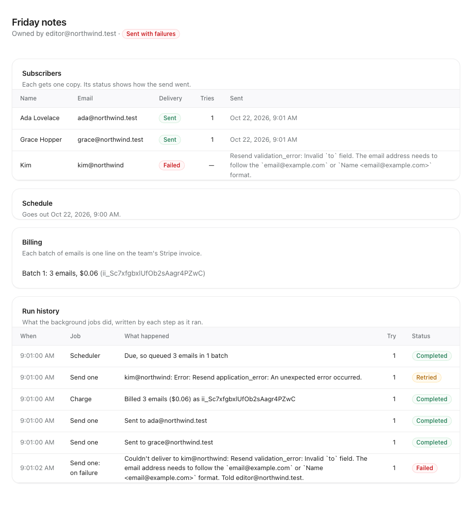
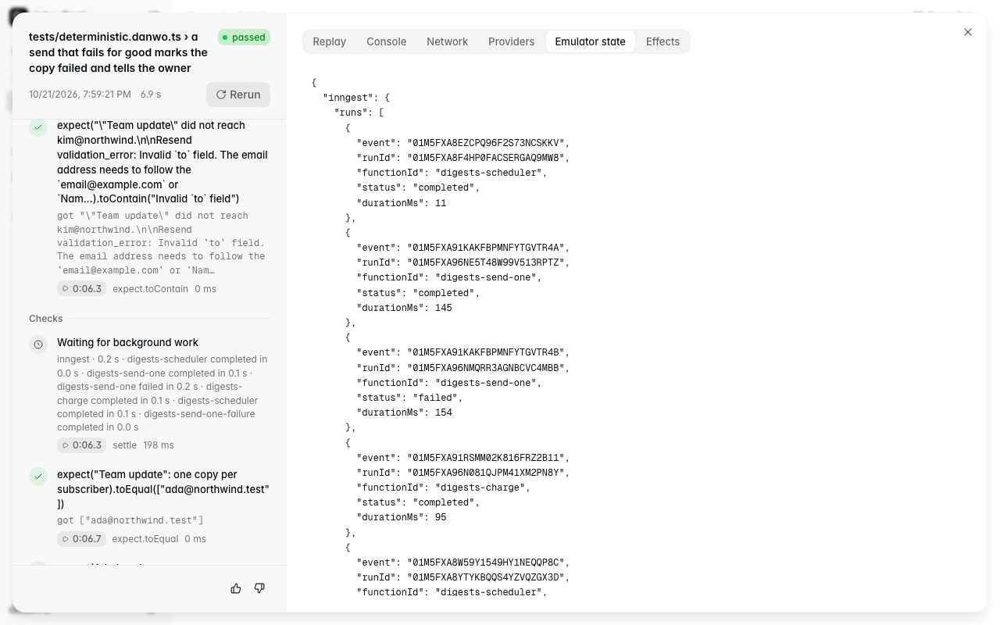

# Background jobs

Northwind Digest is a small team newsletter. You write a digest, add who gets it and pick when it
goes out; background jobs do the rest. A React page (Vite) talks to a Hono API on Postgres, and a
separate worker serves three Inngest functions:

- **`scheduler`**, on the hour (and at once when a digest is scheduled), claims the digests that
  are due and fans each one out: one `digest/send-one` event per subscriber, sent in batches of 50
  with `step.sendEvent`, and one `digest/charge` per batch;
- **`send-one`** renders one subscriber's copy, sends it through Resend and records the delivery.
  Inngest retries a step that throws; once a copy fails for good, its `onFailure` handler marks it
  failed and emails the digest's owner;
- **`charge`** bills the batch to the team's Stripe customer as an invoice item, and records it.

None of those providers is real here, and neither is Inngest's cloud. danwo runs the Inngest dev
server, emulates Resend and Stripe, gives every test empty tables, and blocks every other outside
call.



## What this shows

- **Jobs a test can wait for.** `settle()` waits until every Inngest run the test caused has
  finished: the fan-out, each retry, and the `onFailure` handler a failed run starts. With
  `readiness: { settle: true }` each step waits too, so no test sleeps.
- **Cron through time travel.** A test schedules a digest for tomorrow at 09:00 and calls
  `time.set(...)`. The apps' clocks jump, the hourly `scheduler` falls due on the way and runs at
  the new time, and the events it sends run at once.
- **Invariants that read both sides.** After every test the database is checked against Resend
  and Stripe: one email per subscriber per digest, every copy Resend sent a delivery marked sent
  with that email's id, every failed copy told to its owner once, and one invoice item per batch.
- **A matrix the jobs survive.** `danwo matrix` plans 58 faults on the send: the event sends to
  Inngest (down, answer lost, slow), Resend's 429s, 5xx, timeouts and lost answers, Stripe's 5xx
  and lost answers, and Postgres resets, lost COMMITs, serialization failures and deadlocks inside
  the API and inside the jobs' steps. Inngest's retries and the jobs' idempotency hold under all of
  them.
- **Bugs you can switch on.** `JOBS_BUG` turns the idempotency keys or the steps off, and the
  matrix shows which trials go red.



## Run

Use Node 24 and Docker. From this folder:

```sh
npm install
npm test
```

```text
Running 6 tests with 2 workers
  - tests/agentic.danwo.ts › the agent writes and schedules a digest 0 ms, worker 0
  ✓ tests/deterministic.danwo.ts › sends a scheduled digest to every subscriber once 8668 ms, worker 1
  ✓ tests/deterministic.danwo.ts › retries a send whose answer was lost, and still sends one email 7901 ms, worker 1
  ✓ tests/deterministic.danwo.ts › bills a batch once when Stripe's answer is lost 7802 ms, worker 1
  ✓ tests/deterministic.danwo.ts › a send that fails for good marks the copy failed and tells the owner 6867 ms, worker 1
  ✓ tests/deterministic.danwo.ts › the digests page shows how each send went 9285 ms, worker 1

5 passed, 1 skipped
```

The first run builds the page (`vite build web`) and pulls `postgres:17-alpine`. Each worker then
starts its own Postgres container and pushes the schema with `drizzle-kit push`, starts its own
Inngest dev server (`inngest-cli`, a dev dependency), and starts the worker, the API and
`vite preview` behind danwo's proxy; it removes them all when it ends. If Chromium is missing,
danwo tells you to run `npx @danwo/cli install-browser`.

The scripts:

| Script                | What it runs                                               |
| --------------------- | ---------------------------------------------------------- |
| `npm test`            | every test; the agent test skips without a model key       |
| `npm run matrix:plan` | what the send's fault matrix would try, without running it |
| `npm run matrix`      | the send's fault matrix: 58 trials, about three minutes    |
| `npm run serve`       | danwo's dashboard over everything the runs recorded        |
| `npm run typecheck`   | `tsc` over the API, the worker, the tests and the page     |

### Use your own Postgres

Without Docker, point `DATABASE_URL` at a Postgres you run. Its database name must end in `_test`;
each worker creates `jobs_w0_test`, `jobs_w1_test` and so on beside it, so the role needs
`CREATEDB`:

```sh
DATABASE_URL=postgres://postgres@127.0.0.1:5432/jobs_test npm test
```

## The tests

| Test                                                                 | What it proves                                                                            |
| -------------------------------------------------------------------- | ----------------------------------------------------------------------------------------- |
| sends a scheduled digest to every subscriber once                    | the cron runs at the send time it is travelled to, and fans out three emails and one bill |
| retries a send whose answer was lost, and still sends one email      | Resend took the first email but the step never heard; Inngest's retry sends no second     |
| bills a batch once when Stripe's answer is lost                      | the same for the invoice item                                                             |
| a send that fails for good marks the copy failed and tells the owner | Resend refuses `kim@northwind`; `onFailure` marks it failed and emails the owner          |
| the digests page shows how each send went                            | the list shows one digest sent and one still scheduled                                    |

The two "answer was lost" tests make one call fail from inside the test, with the `proxy` fixture:

```ts
proxy.failNext((call) => call.host === "api.resend.com" && call.path === "/emails", {
  kind: "reset-after",
})
```

## Make it break

`JOBS_BUG` turns the jobs' safeguards off, one or both. Run the send's matrix with it and watch
the trials that catch it go red. Everything else still passes.

**`JOBS_BUG=no-idempotency npm run matrix`** sends to Resend and Stripe without idempotency keys.
One trial fails: Resend took the email but its answer was lost, so Inngest ran the step again and
the subscriber got two copies.

```text
FAIL  reset-after on POST api.resend.com/emails
        invariant: "Friday notes": one copy per subscriber: expected [ 'ada@northwind.test', …(3) ] to deeply equal [ 'ada@northwind.test', …(2) ]
```

The Stripe trials still pass: Stripe's own SDK puts a key on every POST and retries a dropped
connection under it, so only a step that Inngest ran again would bill twice. `npm test` catches
the same bug: "retries a send whose answer was lost" goes red.

**`JOBS_BUG=no-step npm run matrix`** sends the email from the function's body instead of inside
`step.run`. Nothing fails: whenever Inngest runs the function again, the send goes again, but with
the same idempotency key, and Resend answers with the first email.

**`JOBS_BUG=no-idempotency,no-step npm run matrix`** turns both off, and nine trials fail. Every
fault that makes Inngest run the function again now sends another copy: Resend's 429, 500, timeout,
reset and lost answer, and the reset, lost COMMIT, serialization failure and deadlock on the
`UPDATE deliveries` that records the send after it went out.

```text
FAIL  reset on UPDATE deliveries (postgres)
        invariant: "Friday notes": one copy per subscriber: expected [ 'ada@northwind.test', …(4) ] to deeply equal [ 'ada@northwind.test', …(2) ]
```

Either safeguard alone holds the line: the steps mean a later failure never redoes the send, and
the key means a send that is redone is the same email.

To rerun one trial while you fix it, pass its label to `--faults`:

```sh
JOBS_BUG=no-idempotency npx @danwo/cli matrix tests/deterministic.danwo.ts \
  --grep "sends a scheduled digest" --faults "^reset-after on POST api.resend.com"
```

## How the jobs stay correct

| Fault                                      | What the jobs do                                                                                      |
| ------------------------------------------ | ----------------------------------------------------------------------------------------------------- |
| an event send to Inngest fails or is lost  | the SDK retries the send; each event has an `id`, so a resend is the same event and runs once         |
| the API's `digest/scheduled` never arrives | the hourly scheduler finds the digest anyway: what is due lives in Postgres, not in the event         |
| Resend answers 429, 5xx or times out       | the step throws and Inngest retries it, after the 429's pause; the idempotency key makes it one email |
| Resend refuses the address                 | the step throws a `NonRetriableError`; `onFailure` marks the copy failed and emails the owner, once   |
| Stripe answers 5xx or drops the line       | the SDK retries a dropped line under its own key; past that the step is retried under the batch's key |
| Postgres fails a statement in the API      | the transaction runs again from the start; a digest or subscriber id from the page makes it safe      |
| Postgres fails a statement in a step       | the step throws and Inngest retries it; claims, deliveries, charges and history lines are idempotent  |
| a COMMIT lands but its answer is lost      | the scheduler's claim is keyed by its run id, so its retry finds the claim it made                    |
| the page sends a form twice                | the digest or subscriber id comes from the page, so the second insert does nothing                    |

## Agent tests

`tests/agentic.danwo.ts` has one agent test, "the agent writes and schedules a digest", paired with
a check that needs no model: the database holds that one digest, with its two subscribers, scheduled
for tomorrow at 09:00.

It skips without a model key. Set a [Vercel AI Gateway](https://vercel.com/docs/ai-gateway) key to
run it:

```sh
AI_GATEWAY_API_KEY="your-key" npm run test:agentic
```

The first run records each step; later runs replay it with no model calls.

## Against a local build of danwo

To run this example against danwo's source instead of the published packages, while you work
on danwo, build the packages and install the example from them, from the root of the danwo
repository:

```sh
bun install
bun run release 0.1.5 --pack
node examples/link.ts jobs
```

`link.ts` copies the example to a temporary folder, points danwo's packages at the tarballs in
`dist/release`, runs `npm install` there and prints the folder. Run the commands above from it.

To work on the example in this folder, with your editor finding its types, install it in place
instead:

```sh
node examples/link.ts jobs --here
```

That leaves only `node_modules`, which git ignores. The package.json is put back as it was.

## Where things are

| Path              | What it is                                                                         |
| ----------------- | ---------------------------------------------------------------------------------- |
| `web/`            | the React page, built with Vite; `vite preview` passes `/api` to the API           |
| `api/`            | the Hono API: digests, subscribers, scheduling                                     |
| `worker/`         | the Inngest functions, their calls to Resend and Stripe, and their SQL             |
| `lib/inngest.ts`  | the Inngest client and the events between the API and the worker                   |
| `db/schema.ts`    | the Drizzle schema `drizzle-kit push` creates                                      |
| `danwo.config.ts` | the stack, the Inngest dev server, the emulators, the database proxy and snapshots |
| `kit/`            | the examples' shared styles                                                        |
| `tests/`          | the tests, the invariants (`digests.ts`) and the database helpers                  |

Last checked with @danwo/cli 0.1.5, inngest 4.25 with inngest-cli 1.46, Hono 4.13,
Drizzle 0.45, Vite 8.3, React 19.3, Postgres 17 and Node 24.
