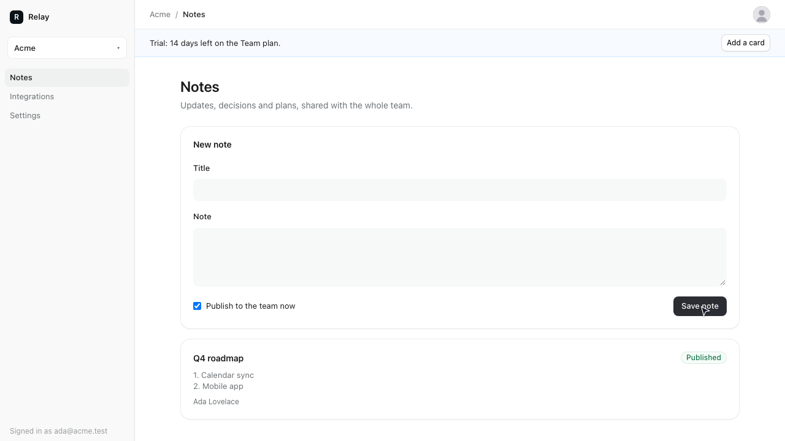
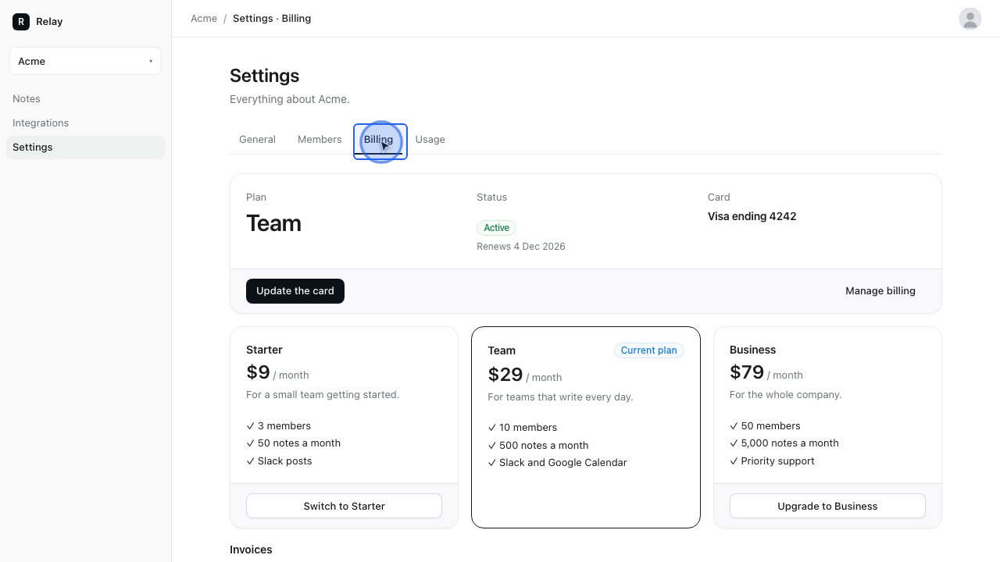

# SaaS with integrations

Relay is a small team-notes app. You sign up with an emailed code, name a workspace and get a
14-day trial of the Team plan. Inside, you write notes and publish them: everyone with the
workspace open sees them arrive live, and they're posted to the team's Slack channel. Settings has
the members (with email invitations), billing (plan cards, a card added on Stripe's page, the
billing portal and the invoices) and usage meters; Integrations connects Slack and Google Calendar.

It's a TanStack Start app in front of a Hono API on Postgres, with background jobs on Inngest. The
workspaces are Clerk organizations, billing is Stripe, live updates go over Pusher and email goes
out through Resend. None of those providers is real here: danwo runs every one as an emulator,
runs the Inngest dev server beside the apps, gives every test a fresh database, and blocks every
other outside call.



## What this shows

- **A whole SaaS stack behind one proxy.** danwo starts the web app, the API, the worker and the
  Inngest dev server, and routes their calls to the Clerk, Stripe, Slack, Google, Pusher and
  Resend emulators, with Postgres behind its data-fault proxy. The app's code has no test hooks.
- **Onboarding that makes one of everything.** One form makes the workspace, its Clerk
  organization, a Stripe customer and a trialing subscription. After every test, an invariant
  reads the database against Clerk and Stripe: one organization, one customer and one live
  subscription per workspace, and the status Relay shows is the one Stripe has.
- **Time travel through a trial.** `time.travel({ days: 11 })` brings Stripe's `trial_will_end`,
  which starts the reminder email; four days later the trial ends, the first invoice is paid and
  the receipt goes out. A card that declines on renewal leaves the workspace past due.
- **Background jobs that run once.** The welcome emails, the reminders and the Slack post are
  Inngest functions, started from an outbox written in the same transaction as their cause. The
  Slack post holds under 429s, 5xx and a lost answer without ever posting twice.
- **Two people in one test.** Ada invites Bob; Bob signs up in his own browser, accepts, and sees
  Ada's note appear without a reload.
- **Bugs you can switch on.** `SAAS_BUG` turns one safeguard off, and the matrix shows which
  trials go red.



## Run

Use Node 24 and Docker. From this folder:

```sh
npm install
npm test
```

```text
Running 11 tests with 2 workers
  - tests/agentic.danwo.ts › invites Bob and shares the roadmap note 0 ms, worker 0
  - tests/agentic.danwo.ts › moves to the plan with room for the most people 0 ms, worker 0
  ✓ tests/integrations.danwo.ts › connects Slack and Google Calendar, and books a review 24101 ms, worker 0
  ✓ tests/billing.danwo.ts › the trial ends and the first invoice is paid 24373 ms, worker 1
  ✓ tests/billing.danwo.ts › a declined renewal marks the workspace past due 11897 ms, worker 1
  ✓ tests/billing.danwo.ts › upgrades to the Business plan 2395 ms, worker 1
  ✓ tests/notes.danwo.ts › posts a published note to Slack once 20429 ms, worker 0
  ✓ tests/onboarding.danwo.ts › signs up and starts a trial 8197 ms, worker 1
  ✓ tests/onboarding.danwo.ts › makes a second workspace from the switcher 3454 ms, worker 1
  ✓ tests/notes.danwo.ts › keeps a draft out of Slack until it is published 8067 ms, worker 0
  ✓ tests/notes.danwo.ts › a teammate sees a published note live 26594 ms, worker 0

9 passed, 2 skipped
```

The first run builds the web app (`vite build web`) and pulls `postgres:17-alpine`. Each worker
then starts its own Postgres container and pushes the schema with `drizzle-kit push`, then starts
the worker, the Inngest dev server (`inngest-cli`, installed with the example), the API and the
web app behind danwo's proxy; it removes them all when it ends. If Chromium is missing, danwo tells
you to run `npx @danwo/cli install-browser`.

The scripts:

| Script                      | What it runs                                                        |
| --------------------------- | ------------------------------------------------------------------- |
| `npm test`                  | every test; the agent tests skip without a model key                |
| `npm run matrix:plan`       | what publishing a note's fault matrix would try, without running it |
| `npm run matrix`            | publishing a note under 52 faults, about three minutes              |
| `npm run matrix:onboarding` | signing up and onboarding under 102 faults, about seven minutes     |
| `npm run matrix:billing`    | the trial ending and the first invoice under 94 faults              |
| `npm run serve`             | danwo's dashboard over everything the runs recorded                 |
| `npm run typecheck`         | `tsc` over the API, the worker, the tests and the web app           |

### Use your own Postgres

Without Docker, point `DATABASE_URL` at a Postgres you run. Its database name must end in `_test`;
each worker creates `relay_w0_test`, `relay_w1_test` and so on beside it, so the role needs
`CREATEDB`:

```sh
DATABASE_URL=postgres://postgres@127.0.0.1:5432/relay_test npm test
```

## Make it break

`SAAS_BUG` turns one of Relay's safeguards off. Run the matrix that covers it and watch the trials
that catch it go red. Everything else still passes.

**`SAAS_BUG=no-onboarding-retry npm run matrix:onboarding`** calls Clerk and Stripe once, with no
retries, no idempotency keys and no slug to find a lost organization by. Ten trials fail: every
Clerk failure on creating the organization (429, 500, 503, a slow answer, a reset, a lost answer)
and Stripe's 429 and 500 on the customer and the subscription. Each leaves a workspace with no
trial; a lost answer leaves a Clerk organization no workspace knows:

```text
FAIL  status 429 on POST api.clerk.com/v1/organizations
        invariant: expected { status: null, trial_days: null } to deeply equal { status: 'trialing', trial_days: 14 }
FAIL  reset-after on POST api.clerk.com/v1/organizations
        invariant: one Clerk organization per workspace: expected [ Array(1) ] to deeply equal []
```

**`SAAS_BUG=no-slack-dedupe npm run matrix`** posts the note without first looking for an earlier
attempt's message. When Slack takes the message but its answer is lost, Inngest retries the step
and the note is posted twice:

```text
FAIL  reset-after on POST slack.com/api/chat.postMessage
        invariant: note 1 is in Slack exactly once: expected [ …(2) ] to have a length of 1 but got 2
```

**`SAAS_BUG=no-webhook-dedupe npm run matrix:billing`** acts on every webhook delivery, and gives
each job it starts a fresh id. Two trials fail: when Stripe sends `trial_will_end` twice Ada gets
two reminders, and when it sends `invoice.paid` twice, two receipts:

```text
FAIL  duplicate on stripe webhook customer.subscription.trial_will_end
        invariant: one trial reminder: expected [ { …(9) }, { …(9) } ] to have a length of 1 but got 2
FAIL  duplicate on stripe webhook invoice.paid
        invariant: one receipt per paid invoice: expected [ 'in_…', …(1) ] to deeply equal [ 'in_…' ]
```

To rerun one trial while you fix it, pass its label to `--faults`:

```sh
SAAS_BUG=no-slack-dedupe npx @danwo/cli matrix tests/notes.danwo.ts \
  --grep "posts a published note" --faults "^reset-after on POST slack.com/api/chat.postMessage"
```

## How Relay stays correct

| Fault                                            | What Relay does                                                                                                                      |
| ------------------------------------------------ | ------------------------------------------------------------------------------------------------------------------------------------ |
| Clerk answers 429, 5xx or drops the line         | retried, waiting as long as a 429 asks; the organization's slug is the workspace's id, so a lost one is found                        |
| Stripe answers 5xx, 429 or drops the line        | the SDK retries with the request's idempotency key, named after the workspace; Relay backs off on 429                                |
| the onboarding form is sent twice                | the form's key makes one workspace; each step records what it made, so a second submit finishes the first                            |
| a webhook arrives twice, late or reordered       | each event is logged with its jobs in one transaction, and the subscription is read back from Stripe, never trusted from the payload |
| a forged or stale webhook                        | the signature check (Stripe's, and Svix for Clerk) refuses it; the provider's retry is signed fresh and lands                        |
| the return from Stripe's page beats its webhook  | both save the card the same way, so whichever lands second changes nothing                                                           |
| Inngest's event send fails or its answer is lost | the job waits in the outbox and is sent again; its id makes a second send start no second run                                        |
| Slack rate-limits, fails or loses the answer     | the step is retried as Slack asks; before posting, it looks for its note's link in the channel                                       |
| Slack revokes the token                          | the integration says it needs attention, and the job stops instead of retrying                                                       |
| Pusher fails                                     | the trigger is retried; the page keys notes by id, so a repeat is ignored, and a missed one shows on reload                          |
| Resend fails or times out                        | the step is retried with the same idempotency key, and a sent email is noted, so it never goes twice                                 |
| Postgres fails a statement or loses a COMMIT     | each write is one transaction, retried from the start; notes and workspaces are keyed by their form, so a retry finds its own row    |

## Agent tests

`tests/agentic.danwo.ts` has two agent tests: "invites Bob and shares the roadmap note" and "moves
to the plan with room for the most people". Each is paired with a check that needs no model: Bob
is invited once and one Roadmap note is published (and in Slack once), and the workspace's plan is
Business, as Stripe bills it.

They skip without a model key. Set a [Vercel AI Gateway](https://vercel.com/docs/ai-gateway) key
to run them:

```sh
AI_GATEWAY_API_KEY="your-key" npm run test:agentic
```

The first run records each step; later runs replay it with no model calls.

## Against a local build of danwo

To run this example against danwo's source instead of the published packages, while you work
on danwo, build the packages and install the example from them, from the root of the danwo
repository:

```sh
bun install
bun run release 0.1.0 --pack
node examples/link.ts saas
```

`link.ts` copies the example to a temporary folder, points danwo's packages at the tarballs in
`dist/release`, runs `npm install` there and prints the folder. Run the commands above from it.

To work on the example in this folder, with your editor finding its types, install it in place
instead:

```sh
node examples/link.ts saas --here
```

That leaves only `node_modules`, which git ignores. The package.json is put back as it was.

## Where things are

| Path              | What it is                                                                        |
| ----------------- | --------------------------------------------------------------------------------- |
| `web/`            | the TanStack Start app: its pages, and the server functions that call the API     |
| `api/`            | the Hono API: onboarding, notes, invitations, billing, integrations, the webhooks |
| `worker/`         | the Inngest functions: the emails and the Slack post                              |
| `shared/`         | the Drizzle schema, the outbox, the Inngest events and the plans                  |
| `danwo.config.ts` | the stack, the emulators and their seeds, the database proxy and the sessions     |
| `kit/`            | the examples' shared styles, used through their Tailwind theme                    |
| `tests/`          | the tests, the steps and invariants (`relay.ts`) and the database helpers         |

Last checked with @danwo/cli 0.1.0, TanStack Start 1.169, Clerk 1.7 for TanStack Start,
Hono 4.13, Inngest 4.25 (dev server 1.46), Drizzle 0.45, Postgres 17 and Node 24.
