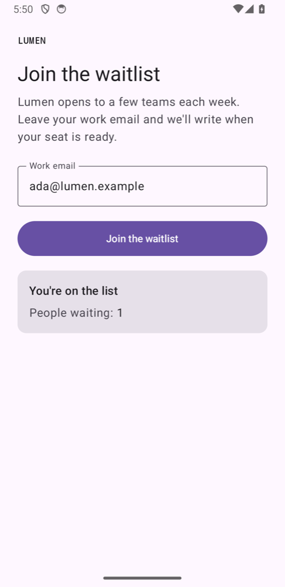

# danwo with Jetpack Compose

A waitlist as a native Jetpack Compose app on the Android emulator. The app posts an email to its
API at `https://api.lumen.example`; the API, a small Hono server, saves it to Postgres and sends a
welcome email through Resend. danwo builds the Gradle project, routes the emulator's traffic
through its proxy to a local copy of the API, and runs Resend as an emulator, so the tests need no
account and no key.



## What this shows

- **A plain Gradle project, no Expo.** `danwo build-android android` runs the project's own
  `./gradlew assembleRelease`, signs the APK with the debug key, and keeps it until the sources
  change. No Gradle or Kotlin daemon is left running.
- **No change to the app's code.** The app calls its production host over HTTPS. For its own
  build, danwo adds a network security config that trusts the certificate it installs on the
  emulator, through a Gradle init script; the project's files are not touched.
- **Locators on Compose.** `Modifier.testTag` is what `getByTestId` finds, once the screen sets
  `testTagsAsResourceId`. A Material `Button` is found by its role and label.
- **An invariant that reads both sides.** However the join went, the email ends with exactly one
  row in Postgres and exactly one welcome email in the Resend emulator.

## Run

Use Android Studio's SDK, an AVD on a **Google APIs** image (danwo needs root to trust its
certificate), Node 24 and Docker. See [Android setup](https://danwo.dev/docs/mobile). From this
folder:

```sh
npm install
DANWO_AVD=danwo_spike npm test
```

```text
Running 4 tests with 1 worker
  - tests/agentic.danwo.ts › the agent joins the waitlist 0 ms, worker 0
  ✓ tests/deterministic.danwo.ts › shows the waitlist form 4645 ms, worker 0
  ✓ tests/deterministic.danwo.ts › asks for a valid email 6770 ms, worker 0
  ✓ tests/deterministic.danwo.ts › joins the waitlist 11474 ms, worker 0

3 passed, 1 skipped
```

`androidWorkers()` in `danwo.config.ts` sizes the run to your machine, an emulator per worker, so
yours may run with more than one worker.

The first run builds the app (about two minutes with a cold Gradle cache) and pulls
`postgres:17-alpine`. `DANWO_AVD` names the AVD to boot (default `danwo_spike`), and
`DANWO_AVD_SNAPSHOT` boots it from a saved snapshot. Without Docker, point `DATABASE_URL` at a
Postgres you run whose database name ends in `_test`.

| Script                 | What it runs                                               |
| ---------------------- | ---------------------------------------------------------- |
| `npm test`             | every test; the agent test skips without a model key       |
| `npm run test:agentic` | the agent test alone                                       |
| `npm run matrix:plan`  | what the join's fault matrix would try, without running it |
| `npm run matrix`       | the join's fault matrix: a clean run, then 18 faults       |
| `npm run serve`        | danwo's dashboard over everything the runs recorded        |
| `npm run typecheck`    | `tsc` over the API and the tests                           |

### Break it on purpose

`danwo matrix` runs one test clean, then once per fault it plans. `npm run matrix:plan` lists
them first:

```sh
npm run matrix:plan
```

```text
clean run passed; 18 faults planned
  status 500 on POST api.lumen.example/join
  reset on POST api.lumen.example/join
  reset-after on POST api.lumen.example/join
  status 429 on POST api.resend.com/emails
  …
  deadlock_detected on UPDATE signups (postgres)
```

The first three fault the app's own call to its API, on the phone. `npm run matrix` runs
them:

```text
faults: 18 passed
19 runs in 412 s
```

| Fault                                          | What keeps it green                                           |
| ---------------------------------------------- | ------------------------------------------------------------- |
| The API answers 500, or the connection drops   | the app retries the join; the API keeps one row and one email |
| The API joined, but its answer was lost        | the retry gets the same row back, and no second email         |
| Resend answers 429 or 500, or the answer drops | the API retries with the same `Idempotency-Key`               |
| The `INSERT` or `UPDATE` fails or is slow      | the API retries an upsert and an update to a fixed value      |

## Agent tests

`tests/agentic.danwo.ts` asks danwo's agent to join in plain words. Set a
[Vercel AI Gateway](https://vercel.com/docs/ai-gateway) key to run it:

```sh
AI_GATEWAY_API_KEY="your-key" npm run test:agentic
```

Without the key, it skips.

## Against a local build of danwo

To run this example against danwo's source instead of the published packages, while you work
on danwo, build the packages and install the example from them, from the root of the danwo
repository:

```sh
bun install
bun run release 0.1.2 --pack
node examples/link.ts with-compose --here
```

## The files

| File                                              | What it does                                                |
| ------------------------------------------------- | ----------------------------------------------------------- |
| `android/`                                        | the Gradle project, with its wrapper                        |
| `android/app/src/main/kotlin/…/WaitlistScreen.kt` | the screen, with the test tags the tests use                |
| `android/app/src/main/kotlin/…/WaitlistApi.kt`    | the call to `api.lumen.example`, retried when it fails      |
| `api/`                                            | the Hono API: the join, Postgres and Resend                 |
| `danwo.config.ts`                                 | the build, the worker's backend and its emulator            |
| `tests/stack/api.ts`                              | the backend: Postgres, the data proxy, Resend and the route |
| `tests/deterministic.danwo.ts`                    | three locator tests; the join's invariant                   |
| `tests/agentic.danwo.ts`                          | an agent test with a model-free check                       |

See [Native Android apps](https://danwo.dev/docs/native-android) for your own app.

Last checked with danwo 0.1.2, AGP 9.4.1, Kotlin 2.4.20, Compose BOM 2026.09.00, an
Android 14 (Google APIs) emulator, Postgres 17 and Node 24.
