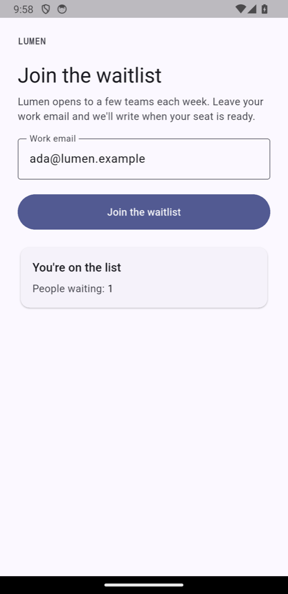

# danwo with Flutter

A waitlist as a Flutter app, on the Android emulator or the iOS Simulator. The app posts an email
to its API at `https://api.lumen.example`; the API, a small Hono server, saves it to Postgres and
sends a welcome email through Resend. danwo builds the app, routes the device's traffic through its
proxy to a local copy of the API, and runs Resend as an emulator, so the tests need no account and
no key.



## What this shows

- **One Flutter app, both platforms.** `danwo build-android app` and `danwo build-ios app` build
  the same app in `app/`, and keep each build until the sources change. `DANWO_PLATFORM=ios`
  runs the tests on the simulator; without it they run on the emulator.
- **No test code in the app.** The app calls its production host over HTTPS. It uses the
  platform's own HTTP stack (`cupertino_http` on iOS, `cronet_http` on Android), which follows the
  device's proxy as a native app does. For the APK, danwo adds a network security config that
  trusts the certificate it installs on the emulator; the project's files are not touched.
- **Locators on Flutter.** A `Semantics` widget's `identifier` is what `getByTestId` finds on both
  platforms. A Material `FilledButton` is found by its role and label.
- **An invariant that reads both sides.** However the join went, the email ends with exactly one
  row in Postgres and exactly one welcome email in the Resend emulator.

## Run

Install Flutter, Node 24 and Docker. For Android, use Android Studio's SDK and an AVD on a
**Google APIs** image (danwo needs root to trust its certificate); see
[Android setup](https://danwo.dev/docs/mobile). For iOS, use Xcode with a simulator
runtime; see [iOS setup](https://danwo.dev/docs/ios-setup). From this folder:

```sh
npm install
npx @danwo/cli test
DANWO_PLATFORM=ios npx @danwo/cli test
```

```text
Running 4 tests with 1 worker
  - tests/agentic.danwo.ts › the agent joins the waitlist 0 ms, worker 0
  ✓ tests/deterministic.danwo.ts › shows the waitlist form 3380 ms, worker 0
  ✓ tests/deterministic.danwo.ts › asks for a valid email 5948 ms, worker 0
  ✓ tests/deterministic.danwo.ts › joins the waitlist 4221 ms, worker 0

3 passed, 1 skipped
```

The first run builds the app (several minutes for the APK with a cold Gradle cache, about a minute
for the simulator) and pulls `postgres:17-alpine`. `DANWO_AVD` names the AVD to boot (default
`danwo_spike`), `DANWO_AVD_SNAPSHOT` boots it from a saved snapshot, and `DANWO_IOS_SIMULATOR`
names the simulator to use (default `danwo iPhone`). Without Docker, point `DATABASE_URL` at a
Postgres you run whose database name ends in `_test`.

### Break it on purpose

`danwo matrix` runs one test clean, then once per fault it plans:

```sh
npx @danwo/cli matrix tests/deterministic.danwo.ts --grep "joins the waitlist" --plan
```

```text
clean run passed; 18 faults planned
  status 500 on POST api.lumen.example/join
  reset on POST api.lumen.example/join
  reset-after on POST api.lumen.example/join
  status 429 on POST api.resend.com/emails
  …
  deadlock_detected on UPDATE signups (postgres)
```

The first three fault the app's own call to its API, on the device. Drop `--plan` to run them;
`npm run matrix` is the same command. On the emulator:

```text
faults: 18 passed
19 runs in 159 s
```

and on the simulator, with `DANWO_PLATFORM=ios`:

```text
faults: 18 passed
19 runs in 410 s
```

| Fault                                          | What keeps it green                                           |
| ---------------------------------------------- | ------------------------------------------------------------- |
| The API answers 500, or the connection drops   | the app retries the join; the API keeps one row and one email |
| The API joined, but its answer was lost        | the retry gets the same row back, and no second email         |
| Resend answers 429 or 500, or the answer drops | the API retries with the same `Idempotency-Key`               |
| The `INSERT` or `UPDATE` fails or is slow      | the API retries an upsert and an update to a fixed value      |

## Agent tests

`tests/agentic.danwo.ts` asks danwo's agent to join in plain words. Set a
[Vercel AI Gateway](https://vercel.com/docs/ai-gateway) key to run it:

```sh
AI_GATEWAY_API_KEY="your-key" npx @danwo/cli test
```

Without the key, it skips.

## Against a local build of danwo

To run this example against danwo's source instead of the published packages, while you work
on danwo, build the packages and install the example from them, from the root of the danwo
repository:

```sh
bun install
bun run release 0.1.1 --pack
node examples/link.ts with-flutter --here
```

## The files

| File                           | What it does                                                |
| ------------------------------ | ----------------------------------------------------------- |
| `app/`                         | the Flutter app, with its `android/` and `ios/` projects    |
| `app/lib/main.dart`            | the screen, with the Semantics identifiers the tests use    |
| `app/lib/waitlist_api.dart`    | the call to `api.lumen.example`, retried when it fails      |
| `api/`                         | the Hono API: the join, Postgres and Resend                 |
| `danwo.config.ts`              | the build, the worker's backend and its device              |
| `tests/stack/api.ts`           | the backend: Postgres, the data proxy, Resend and the route |
| `tests/deterministic.danwo.ts` | three locator tests; the join's invariant                   |
| `tests/agentic.danwo.ts`       | an agent test with a model-free check                       |

See [Flutter](https://danwo.dev/docs/flutter) for your own app.

Last checked with danwo 0.1.1, Flutter 3.47.7, `http` 1.6.0, `cupertino_http` 3.1.0,
`cronet_http` 1.10.0, an Android 14 (Google APIs) emulator, an iOS 26.5 simulator, Postgres 17
and Node 24.
