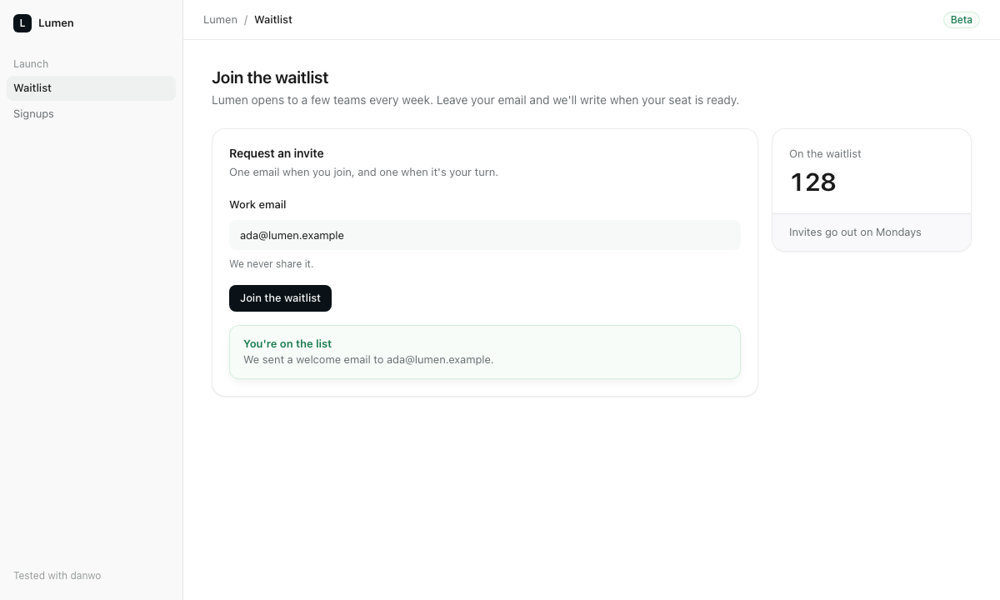

# danwo with Next.js

A waitlist on the Next.js App Router. The form posts an email to a route handler, which saves it
to Postgres and sends a welcome email through Resend; the page then confirms and shows how many
people are waiting. danwo runs it against its Resend emulator and a throwaway Postgres, so the
tests need no Resend account and no key.



## What this shows

- **An invariant that reads both sides.** However the join went, the email ends with exactly one
  row in Postgres and exactly one welcome email in the Resend emulator.
- **A fault matrix across every layer.** `danwo matrix` fails Resend (429, 500, a lost answer),
  the app's own SQL through danwo's data proxy (dropped connections, a slow or failed `INSERT`),
  and submits the form twice at once. The app survives all of them.
- **Fast isolation.** Each worker gets its own database, snapshotted once and restored before
  every test and trial, with no app restart.

## Run

Use Node 24 and Docker. From this folder:

```sh
npm install
npx @danwo/cli test
```

```text
Running 5 tests with 2 workers
  - tests/agentic.danwo.ts › the agent joins the waitlist 0 ms, worker 0
  - tests/agentic.danwo.ts › the agent finds the invalid-email error 0 ms, worker 0
  ✓ tests/deterministic.danwo.ts › shows the waitlist form 998 ms, worker 1
  ✓ tests/deterministic.danwo.ts › asks for a valid email 1413 ms, worker 1
  ✓ tests/deterministic.danwo.ts › joins the waitlist 1565 ms, worker 1

3 passed, 2 skipped
```

The first run builds the app (`next build`) and pulls `postgres:17-alpine`. Each worker then
starts its own Postgres container, Resend emulator and `next start`, and removes them when it
ends. If Chromium is missing, danwo tells you to run `npx playwright-core install chromium`.

### Use your own Postgres

Without Docker, point `DATABASE_URL` at a Postgres you run. Its database name must end in `_test`;
each worker creates `waitlist_w0_test`, `waitlist_w1_test` and so on beside it, so the role needs
`CREATEDB`:

```sh
DATABASE_URL=postgres://postgres@127.0.0.1:5432/waitlist_test npx @danwo/cli test
```

### Break it on purpose

`danwo matrix` runs one test clean, then once per fault it plans. `--plan` lists them first:

```sh
npx @danwo/cli matrix tests/deterministic.danwo.ts --grep "joins the waitlist" --plan
```

```text
clean run passed; 16 faults planned
  status 429 on POST api.resend.com/emails
  status 500 on POST api.resend.com/emails
  delay 10000ms on POST api.resend.com/emails
  reset on POST api.resend.com/emails
  reset-after on POST api.resend.com/emails
  reset on INSERT signups (postgres)
  reset-after on INSERT signups (postgres)
  delay 5000ms on INSERT signups (postgres)
  serialization_failure on INSERT signups (postgres)
  deadlock_detected on INSERT signups (postgres)
  reset on UPDATE signups (postgres)
  reset-after on UPDATE signups (postgres)
  delay 5000ms on UPDATE signups (postgres)
  serialization_failure on UPDATE signups (postgres)
  deadlock_detected on UPDATE signups (postgres)
  double-submit on POST /api/join
```

Drop `--plan` to run them; `npm run matrix` is the same command. Then open the dashboard over what
the runs recorded:

```sh
npx @danwo/cli serve
```

### What keeps it green

| Fault                                                 | What the app does                                                         |
| ----------------------------------------------------- | ------------------------------------------------------------------------- |
| Resend answers 429 or 500, or drops                   | retries, waiting at least the 429's `Retry-After`                         |
| Resend sent it, but the answer was lost               | retries with the same `Idempotency-Key`, so Resend returns the first send |
| The `INSERT` was lost, or ran but its answer was lost | retries an upsert: one row per email, whichever happened                  |
| The form is sent twice at once                        | both requests reach the same row and the same idempotency key: one email  |

Remove the idempotency key in `lib/mail.ts` and `reset-after on POST api.resend.com/emails`
fails: the retry sends a second welcome email, and the invariant counts two.

## Agent tests

`tests/agentic.danwo.ts` asks danwo's agent to join in plain words. Set a
[Vercel AI Gateway](https://vercel.com/docs/ai-gateway) key to run them:

```sh
AI_GATEWAY_API_KEY="your-key" npx @danwo/cli test
```

Without the key, they skip. Each agent step is paired with a check that needs no model, and danwo
keeps the verified steps in `.danwo/cache`, so later runs replay them without calling the model.

## Before danwo's beta is on npm

This folder pins `@danwo/cli` and `@danwo/sdk` at `0.1.0-beta.0`. Until that version is published,
build the packages and install this example from them, from the root of the danwo repository:

```sh
bun install
bun run release 0.1.0-beta.0 --pack
node examples/link.ts with-next
```

`link.ts` copies the example to a temporary folder, points danwo's packages at the tarballs in
`dist/release`, runs `npm install` there and prints the folder. Run the commands above from it.

## The files

| File                           | What it does                                                         |
| ------------------------------ | -------------------------------------------------------------------- |
| `app/api/join/route.ts`        | the route handler the form posts to                                  |
| `lib/waitlist.ts`              | the join: upsert the row, send the welcome email once, mark it sent  |
| `lib/mail.ts`, `lib/db.ts`     | Resend and Postgres, each with retries for what is safe to repeat    |
| `danwo.config.ts`              | the worker's Postgres, data proxy, snapshot, Resend emulator and app |
| `tests/deterministic.danwo.ts` | three locator tests; the join's invariant                            |
| `tests/agentic.danwo.ts`       | two agent tests, each with a model-free check                        |
| `kit/`                         | the examples' shared styles, used with Tailwind                      |

For your own app, start with the [Quickstart](https://danwo.dev/docs/quickstart).

Last checked with danwo 0.1.0-beta.0, Next.js 16.4, Postgres 17, and Node 24.
