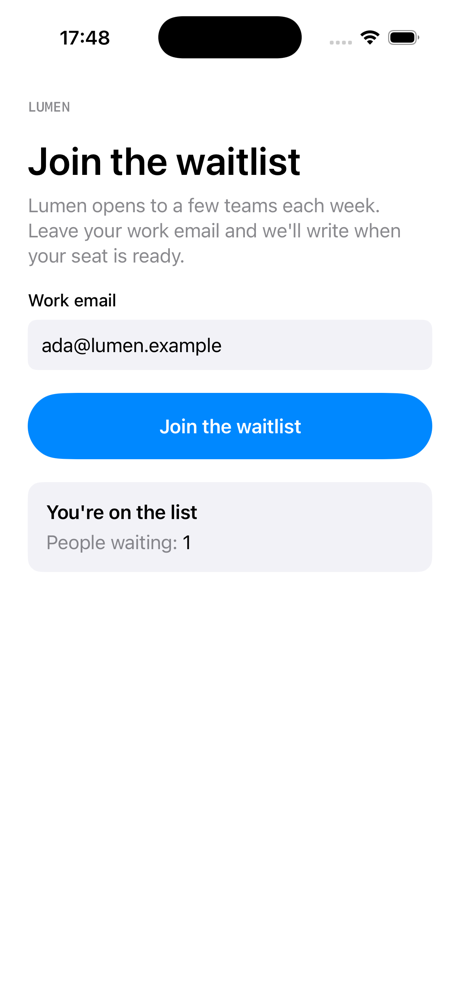

# danwo with SwiftUI

A waitlist as a native SwiftUI app on the iOS Simulator. The app posts an email to its API at
`https://api.lumen.example`; the API, a small Hono server, saves it to Postgres and sends a welcome
email through Resend. danwo builds the Xcode project, routes the simulator's traffic through its
proxy to a local copy of the API, and runs Resend as an emulator, so the tests need no account and
no key.



## What this shows

- **A plain Xcode project, no Expo.** `danwo build-ios ios` builds `Lumen.xcodeproj` for the
  simulator, unsigned, and keeps the build until the Swift sources change.
- **No change to the app.** The app calls its production host over HTTPS. danwo sets the
  simulator's own proxy and trusts its certificate there, so `URLSession` reaches the worker's API.
- **Locators on native views.** `accessibilityLabel` is what `getByLabel` finds, and
  `accessibilityIdentifier` is what `getByTestId` finds.
- **An invariant that reads both sides.** However the join went, the email ends with exactly one
  row in Postgres and exactly one welcome email in the Resend emulator.

## Run

Use a Mac with Xcode, Node 24 and Docker. From this folder:

```sh
npm install
npm test
```

```text
Running 4 tests with 1 worker
  - tests/agentic.danwo.ts › the agent joins the waitlist 0 ms, worker 0
  ✓ tests/deterministic.danwo.ts › shows the waitlist form 8103 ms, worker 0
  ✓ tests/deterministic.danwo.ts › asks for a valid email 12149 ms, worker 0
  ✓ tests/deterministic.danwo.ts › joins the waitlist 15643 ms, worker 0

3 passed, 1 skipped
```

`iosWorkers()` in `danwo.config.ts` sizes the run to your Mac, a simulator per worker, so yours
may run with two or three workers.

The first run builds the app (about 10 s), creates danwo's simulator, `danwo iPhone`, on the
newest iOS, and pulls `postgres:17-alpine`. Set `DANWO_IOS_SIMULATOR` to use a simulator of
another name. Each worker starts its own Postgres container, Resend emulator and API, and stops
them when it ends.

Without Docker, point `DATABASE_URL` at a Postgres you run whose database name ends in `_test`;
each worker creates `waitlist_w0_test` and so on beside it.

| Script                 | What it runs                                               |
| ---------------------- | ---------------------------------------------------------- |
| `npm test`             | every test; the agent test skips without a model key       |
| `npm run test:agentic` | the agent test alone                                       |
| `npm run matrix:plan`  | what the join's fault matrix would try, without running it |
| `npm run matrix`       | the join's fault matrix: a clean run, then 18 faults       |
| `npm run serve`        | danwo's dashboard over everything the runs recorded        |
| `npm run typecheck`    | `tsc` over the API and the tests                           |

### Break it on purpose

`danwo matrix` runs one test clean, then once per fault it plans. `npm run matrix:plan` lists
them first:

```sh
npm run matrix:plan
```

```text
clean run passed; 18 faults planned
  status 500 on POST api.lumen.example/join
  reset on POST api.lumen.example/join
  reset-after on POST api.lumen.example/join
  status 429 on POST api.resend.com/emails
  status 500 on POST api.resend.com/emails
  delay 10000ms on POST api.resend.com/emails
  …
  deadlock_detected on UPDATE signups (postgres)
```

The first three fault the app's own call to its API, on the phone. `npm run matrix` runs
them:

```text
faults: 18 passed
19 runs in 240 s
```

| Fault                                          | What keeps it green                                           |
| ---------------------------------------------- | ------------------------------------------------------------- |
| The API answers 500, or the connection drops   | the app retries the join; the API keeps one row and one email |
| The API joined, but its answer was lost        | the retry gets the same row back, and no second email         |
| Resend answers 429 or 500, or the answer drops | the API retries with the same `Idempotency-Key`               |
| The `INSERT` or `UPDATE` fails or is slow      | the API retries an upsert and an update to a fixed value      |

To see it break, make `join` in `ios/Lumen/WaitlistAPI.swift` call `attempt` once, with no retry.
Two trials fail, `status 500` and `reset` on `api.lumen.example/join`, each with
`expected [] to have a length of 1 but got +0`: the app gave up and nobody joined.

## Agent tests

`tests/agentic.danwo.ts` asks danwo's agent to join in plain words. Set a
[Vercel AI Gateway](https://vercel.com/docs/ai-gateway) key to run it:

```sh
AI_GATEWAY_API_KEY="your-key" npm run test:agentic
```

Without the key, it skips.

## Against a local build of danwo

To run this example against danwo's source instead of the published packages, while you work
on danwo, build the packages and install the example from them, from the root of the danwo
repository:

```sh
bun install
bun run release 0.1.4 --pack
node examples/link.ts with-swiftui --here
```

## The files

| File                           | What it does                                                |
| ------------------------------ | ----------------------------------------------------------- |
| `ios/Lumen.xcodeproj`          | the Xcode project, with its shared `Lumen` scheme           |
| `ios/Lumen/WaitlistView.swift` | the screen, with the labels and identifiers the tests use   |
| `ios/Lumen/WaitlistAPI.swift`  | the call to `api.lumen.example`, retried when it fails      |
| `api/`                         | the Hono API: the join, Postgres and Resend                 |
| `danwo.config.ts`              | the build, the worker's backend and its simulator           |
| `tests/stack/api.ts`           | the backend: Postgres, the data proxy, Resend and the route |
| `tests/deterministic.danwo.ts` | three locator tests; the join's invariant                   |
| `tests/agentic.danwo.ts`       | an agent test with a model-free check                       |

See [Native iOS apps](https://danwo.dev/docs/native-ios) for your own app.

Last checked with danwo 0.1.4, Xcode 26.6, iOS 26.5, Postgres 17 and Node 24.
